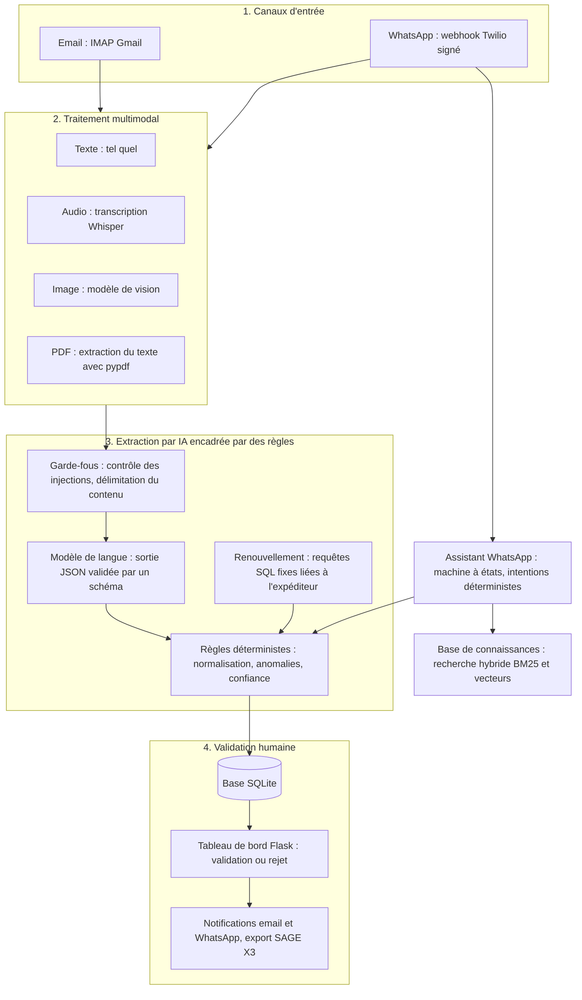

# TECPAP : saisie automatique des commandes par email et WhatsApp

TECPAP fabrique des sacs en papier kraft à Bouskoura (Casablanca). Ses clients commandent par email (texte, PDF, images en pièce jointe) et par WhatsApp (texte, notes vocales, photos, PDF), en français, en darija (arabe marocain, écrit en lettres arabes ou en lettres latines avec des chiffres, l'« arabizi ») et en arabe standard.

Ce dépôt contient le système qui lit ces messages, en extrait la commande, la prépare pour l'ERP SAGE X3 et la soumet à la validation de l'équipe commerciale dans un tableau de bord. Un assistant WhatsApp conversationnel complète les commandes avec le client, renouvelle une commande habituelle, donne l'état d'une commande et répond aux questions sur les produits.

Le principe directeur : un modèle de langue (LLM, Large Language Model) n'est jamais la seule source de vérité. Ses réponses sont validées par un schéma, contrôlées par des règles déterministes, soumises à des autorisations vérifiées dans le code, puis validées par une personne.

Version 3.0.0. Auteur : Salah Eddine EL AZOUTI.

## Sommaire

1. [Contexte et problème](#contexte-et-problème)
2. [Ce que fait le système](#ce-que-fait-le-système)
3. [Fonctionnalités](#fonctionnalités)
4. [Principes de conception](#principes-de-conception)
5. [Démarrage rapide](#démarrage-rapide)
6. [Configuration](#configuration)
7. [Évaluation](#évaluation)
8. [Tests et qualité](#tests-et-qualité)
9. [Structure du dépôt](#structure-du-dépôt)
10. [Documentation](#documentation)
11. [Limites connues](#limites-connues)
12. [Auteur](#auteur)

## Contexte et problème

Les commandes arrivent sous des formes très diverses : un bon de commande en PDF, un email de deux lignes, une photo d'un bon manuscrit, une note vocale en darija mêlée de français, un message comme « kif dima » (« comme d'habitude »). Chaque message doit être lu, converti en commande (client, produit, quantité, unité, prix, date de livraison), ressaisi dans l'ERP SAGE X3 puis confirmé au client.

Cette saisie manuelle est lente, sujette aux erreurs de recopie et dépend de la langue du message. Elle retarde la réponse au client. L'équipe TECPAP rapporte, avec le système, un gain de plus de 70 % sur le temps de réponse au client. Ce chiffre est un résultat rapporté par l'équipe : le dépôt ne le mesure pas.

L'automatisation pose deux risques que le système traite explicitement :

- un modèle de langue peut se tromper ou inventer une valeur (un prix, une quantité) ;
- un message peut contenir des instructions écrites pour détourner le modèle de sa tâche (injection d'instructions, ou prompt injection) et, dans un assistant conversationnel, pour faire fuiter des données d'un autre client.

## Ce que fait le système

Le système est organisé en quatre couches, de l'arrivée du message à la validation humaine.



1. **Canaux d'entrée.** Les emails sont lus par IMAP (boîte Gmail). Les messages WhatsApp arrivent par un webhook (adresse que Twilio appelle à chaque message reçu) dont la signature est vérifiée.
2. **Traitement multimodal.** Le texte est pris tel quel. Une note vocale est transcrite (Whisper), une image est lue par un modèle de vision, un PDF est converti en texte avec pypdf. Tout devient du texte.
3. **Extraction par IA encadrée par des règles.** Un modèle de langue à basse température renvoie un objet JSON, validé par un schéma. Des règles déterministes normalisent chaque champ (quantités, unités, dates, produits), relèvent les anomalies, listent les champs manquants et calculent la confiance. Un renouvellement reprend les champs manquants dans la dernière commande validée du même expéditeur, par des requêtes SQL fixes : le modèle n'a jamais d'accès libre à la base.
4. **Validation humaine.** Chaque commande reste « en attente » jusqu'à sa validation ou son rejet par l'équipe commerciale. La décision déclenche l'envoi de notifications au client et alimente l'export SAGE X3.

L'assistant WhatsApp, la base de connaissances et les garde-fous de sécurité s'ajoutent à ces couches (voir [Fonctionnalités](#fonctionnalités)).

### Déroulement du traitement d'un message

1. Le texte est nettoyé : forme Unicode normalisée, caractères de contrôle et caractères invisibles retirés.
2. Le contenu est contrôlé par le détecteur d'injection d'instructions. Un contenu suspect est signalé par une anomalie et par un événement de sécurité, mais la commande n'est jamais écartée : l'équipe commerciale en décide.
3. La langue est détectée par des règles. Le modèle est choisi selon la tâche et la langue (voir [docs/choix_des_modeles.md](docs/choix_des_modeles.md)).
4. Le modèle reçoit le message dans un bloc délimité, accompagné d'au plus trois commandes validées proches, anonymisées et sans prix, comme exemples.
5. Sa réponse JSON est validée par le schéma, puis normalisée par les règles. La confiance est calculée par les règles : moyenne de la confiance déclarée par le modèle et de la complétude de la commande, moins 10 points par anomalie, plafonnée à la complétude plus 10 points.
6. La commande est enregistrée au statut « en attente », avec la trace de son extraction : message d'origine, langue, modèle utilisé et raison de ce choix, anomalies, champs manquants.
7. L'équipe commerciale valide ou rejette la commande. Le client est prévenu par email ou par WhatsApp, dans sa langue.

Sans clé d'API, ou si l'appel au modèle échoue, l'extraction par règles fixes prend le relais : la commande arrive quand même au tableau de bord, avec une anomalie qui demande de vérifier tous les champs, et une confiance plafonnée.

## Fonctionnalités

### Canaux d'entrée et traitement multimodal

- **Email.** Lecture IMAP par identifiant de message (UID) à partir de la dernière position traitée : aucun email n'est laissé de côté. Un email déjà enregistré est ignoré avant tout appel au modèle. Les pièces jointes (PDF, images, notes vocales, fichiers texte) sont converties en texte ; leur type est reconnu d'après leur contenu, pas d'après leur nom. Le traitement se lance à la demande, depuis la page « Emails » du tableau de bord ou avec `python scripts/process_emails.py` ; aucun relevé automatique de la boîte n'est planifié.
- **WhatsApp.** Le webhook refuse toute requête dont la signature Twilio est invalide. Un message accepté est enregistré dans une file durable avant la réponse à Twilio, puis traité en tâche de fond : il n'est pas perdu si le processus s'arrête. Un message livré deux fois n'est traité qu'une fois. Le nombre de messages par minute et par numéro est limité, avant tout téléchargement de média payant.
- **Médias.** Notes vocales, photos, PDF et fichiers texte sont convertis en texte. Un PDF scanné sans couche de texte n'est pas lu (voir [Limites connues](#limites-connues)).

### Extraction encadrée par des règles

- Lecture des quantités écrites en chiffres ou en lettres, en français, en anglais, en darija et en arabe (« jouj alaf », « ثلاث آلاف »).
- Normalisation des unités, des devises, des dates, du type de produit (quatre familles de sacs du catalogue) et du nom du client.
- Anomalies relevées : quantité nulle ou invraisemblable, prix total qui ne correspond pas à quantité fois prix unitaire, date de livraison passée, grammage ou laize hors des valeurs usuelles, produit hors catalogue, nom de client provisoire.
- Champs obligatoires : client, type de produit, quantité. Un champ manquant est listé, jamais inventé.
- Détection des renouvellements (« comme d'habitude », « kif dima », « كالعادة », « same as usual ») par des règles ; le modèle léger n'est consulté que pour un texte assez long dont les règles ne tirent rien. Pour un renouvellement, seule la dernière commande validée envoyée par le même expéditeur sert de source : le nom d'un client cité dans le message ne donne jamais accès à l'historique de ce client.
- Code article SAGE X3 calculé par des règles à partir du type de papier, du grammage, de la laize et du fournisseur (exemple de format : `KB100L28MON`).

### Assistant WhatsApp

L'assistant est une machine à états : le déroulement de la conversation est décidé par du code et par des intentions détectées par règles, en français, en anglais, en arabe standard et en darija. Le modèle de langue n'intervient qu'en appui.

- Prise de commande guidée : l'assistant demande les champs manquants, envoie un récapitulatif et n'enregistre la commande qu'après un accord explicite du client (« oui », « wakha », « نعم »). La commande est toujours enregistrée « en attente ».
- Renouvellement d'une commande habituelle à partir de la dernière commande validée de l'expéditeur.
- Suivi : état des dernières commandes envoyées depuis le numéro de l'expéditeur.
- Questions sur les produits : réponses fondées sur la base de connaissances.
- Transfert à un conseiller (handoff) : sur demande explicite du client (« conseiller »), pour une demande d'annulation d'une commande déjà envoyée ou pour une question sur les prix, les délais, le stock, les remises ou le paiement. La conversation passe à l'état « transfert » et apparaît dans la page « Conversations » du tableau de bord. L'équipe commerciale peut y répondre et remettre la conversation à zéro.
- Réponses en français, en darija ou en arabe standard, selon la langue de la conversation.
- Les outils de l'assistant ne reçoivent jamais de numéro ni d'identifiant en paramètre : ils sont construits pour le numéro de l'expéditeur et chaque requête SQL filtre elle-même sur ce numéro.

Détails : [docs/assistant_whatsapp.md](docs/assistant_whatsapp.md).

### Base de connaissances et recherche (RAG)

L'assistant répond aux questions sur les produits par génération augmentée par la recherche (RAG, Retrieval-Augmented Generation) : il cherche les extraits pertinents d'une base de documents, puis rédige une réponse uniquement à partir d'eux.

- Documents : cinq fichiers Markdown du dossier `knowledge/`, découpés en 53 extraits. Le guide de rédaction `knowledge/_guide_redaction.md` explique comment les modifier.
- Recherche hybride : classement par mots-clés (Okapi BM25, fonction de score fondée sur la fréquence des mots) et classement par similarité de vecteurs, fusionnés par fusion par rangs réciproques (RRF, Reciprocal Rank Fusion : chaque extrait reçoit la somme de 1 / (60 + rang) sur les deux classements).
- Vecteurs calculés localement par défaut (hors ligne, gratuit, déterministe) ou par un modèle d'embedding OpenAI (`RAG_EMBEDDER`).
- Seuil de pertinence (`RAG_MIN_SCORE`) : sous le seuil, l'assistant répond qu'il n'a pas l'information et invite le client à écrire « conseiller ». Cette réponse ne transfère pas la conversation automatiquement.
- Contrôle de la réponse : un montant, une durée ou un pourcentage absent des extraits fait remplacer la réponse par un message qui renvoie vers l'équipe commerciale.

Détails : [docs/rag.md](docs/rag.md).

### Garde-fous de sécurité

- Détecteur d'injection d'instructions par signaux pondérés en français, anglais, arabe et darija, avec décodage des contenus encodés (base64, hexadécimal, encodage d'URL).
- Délimitation du contenu externe : le texte du client est placé entre balises et présenté au modèle comme une donnée, jamais comme une instruction.
- Jeton témoin (canary token) : code aléatoire placé dans les consignes système (system prompt), renouvelé à chaque message ; sa présence dans une réponse prouve une fuite de ces consignes.
- Filtre de sortie : une réponse qui contient le jeton témoin, une reprise des consignes système, une requête SQL, un secret ou des coordonnées non autorisées est bloquée et remplacée par un message fixe.
- Masquage des numéros de téléphone et des adresses email dans le journal des événements de sécurité.
- Webhook : signature Twilio obligatoire, corps de requête limité à 1 Mo.
- Tableau de bord : connexion obligatoire, protection contre la falsification de requête intersite (CSRF), blocage après trop d'échecs de connexion, en-têtes HTTP de sécurité.

Ces contrôles sont une défense en profondeur. La protection de fond est dans le code : les autorisations ne dépendent pas du comportement du modèle. Détails : [docs/securite.md](docs/securite.md) et [SECURITY.md](SECURITY.md).

### Tableau de bord de l'équipe commerciale

| Page | Contenu |
|---|---|
| `/` | Indicateurs par canal, tendance sur 7 jours, meilleurs clients et produits les plus commandés |
| `/orders`, `/orders/<id>` | Liste filtrée, détail, modification, validation et rejet |
| `/clients`, `/clients/<id>` | Clients et historique de leurs commandes |
| `/process` | Traitement des emails, avec barre de progression |
| `/whatsapp` | Indicateurs du canal WhatsApp |
| `/conversations` | Conversations de l'assistant, réponse de l'équipe commerciale, remise à zéro |
| `/knowledge` | Documents de la base de connaissances, réindexation, recherche d'essai |
| `/analytics`, `/alerts` | Statistiques et alertes |
| `/sage` | Préparation de l'export SAGE X3 |
| `/backups` | Sauvegardes de la base |
| `/security` | Tentatives d'injection, réponses bloquées, limites de débit, signatures refusées |

Le tableau de bord interroge périodiquement `/api/notifications/check` pour signaler les commandes arrivées. La liste complète des routes est dans [docs/api.md](docs/api.md).

### Export vers SAGE X3

Le système produit un fichier Excel au format d'import SAGE X3 (`/export/excel/sage`) ; il n'est pas connecté à l'ERP par une API.

- L'export ne contient que les commandes **validées** ; tout autre statut donne une page d'erreur qui explique le refus. Une période peut être précisée avec `date_from` et `date_to` (jours inclus, heure de Casablanca par défaut, réglage `APP_TIMEZONE`).
- Le classeur compte deux feuilles. La feuille d'import contient les quantités en unités de stock ou en pièces. La feuille « Unités à convertir » contient les commandes validées en carton, paquet ou kilogramme : le projet ne contient aucun coefficient de conversion, ces quantités ne sont donc pas converties.
- Dans les exports Excel, CSV et SAGE, un texte qui commence par `=`, `+`, `-` ou `@` reste du texte et n'est jamais évalué comme une formule.
- Les exports Excel (`/export/excel`), CSV (`/export/csv`) et le rapport PDF (`/export/pdf`) sont disponibles aux mêmes adresses.

### Sauvegardes

- Sauvegarde automatique toutes les 6 heures (`BACKUP_INTERVAL_HOURS`), avec conservation des 20 plus récentes (`BACKUP_KEEP`), au format compressé `.db.gz`.
- Les copies utilisent l'API de sauvegarde de SQLite : elles sont cohérentes même si l'application écrit au même moment.
- Page `/backups` : création, téléchargement, restauration (une copie de la base est faite juste avant, pour pouvoir revenir en arrière), suppression, export JSON complet, réglage du planificateur.
- Ligne de commande : `python scripts/backup.py` avec l'une des commandes `backup`, `list`, `restore`, `clean N`, `stats` ou `export`.

## Principes de conception

1. **Le modèle de langue n'est jamais la seule source de vérité.** Sa sortie est validée par un schéma, complétée et contrôlée par des règles qui donnent toujours le même résultat pour le même texte, puis vérifiée par une personne. Quand le modèle est absent, les règles prennent le relais.
2. **Les autorisations sont dans le code, pas dans les consignes du modèle.** Les outils de l'assistant sont liés au numéro de l'expéditeur, les requêtes SQL sont fixes et paramétrées, les résultats sont réduits au minimum (jamais de prix, jamais de coordonnées d'un autre client). Une consigne ajoutée dans un message ne peut pas élargir ces droits.
3. **Validation humaine.** Aucune commande ne devient « validée » sans l'équipe commerciale. Même une commande confirmée par le client sur WhatsApp reste « en attente ».
4. **Ne jamais inventer.** Un champ absent est signalé, pas deviné. L'assistant ne donne ni prix ni délai : ces questions sont transmises à l'équipe commerciale.
5. **Des chiffres vérifiables.** Les composants déterministes sont évalués sur un corpus annoté, avec un jeu de test tenu à l'écart du réglage et des intervalles de confiance (voir [Évaluation](#évaluation)).
6. **Un seul point d'accès aux modèles.** Tous les appels aux modèles passent par `tecpap/llm/client.py`, qui tente au plus un second appel après une erreur passagère, ne journalise jamais le contenu des messages et renvoie `None` en cas d'erreur au lieu de lever une exception.

## Démarrage rapide

Prérequis : Python 3.11 ou plus récent.

### 1. Installer

```bash
python -m venv .venv
source .venv/bin/activate          # Windows (PowerShell) : .venv\Scripts\Activate.ps1
pip install -r requirements-dev.txt
```

`requirements-dev.txt` contient aussi les dépendances d'exécution. Pour exécuter l'application sans outils de développement : `pip install -r requirements.txt`.

### 2. Configurer

```bash
cp .env.example .env
python scripts/hash_password.py
```

Le script demande le mot de passe administrateur deux fois (12 caractères au minimum) et affiche la ligne `ADMIN_PASSWORD_HASH='...'` à copier dans `.env`. Les apostrophes protègent les caractères `$` de l'empreinte ; gardez-les. Sans empreinte, aucune connexion n'est possible : il n'existe pas de mot de passe par défaut.

Renseignez ensuite dans `.env` les services dont vous avez besoin (une variable vide laisse le service désactivé) :

- `OPENAI_API_KEY` : extraction par modèle de langue, transcription, lecture d'images ;
- `GMAIL_EMAIL` et `GMAIL_APP_PASSWORD` : réception et envoi d'emails (mot de passe d'application Gmail, jamais le mot de passe du compte) ;
- `TWILIO_ACCOUNT_SID`, `TWILIO_AUTH_TOKEN` et `PUBLIC_BASE_URL` : WhatsApp.

### 3. Lancer

```bash
python app.py
```

Le tableau de bord est servi sur `http://127.0.0.1:5000` (`FLASK_HOST`, `FLASK_PORT`). L'index de la base de connaissances est actualisé au démarrage quand `RAG_ENABLED` est vrai. Pour le recalculer à la main : `python scripts/build_knowledge_index.py` (option `--force` pour recalculer tous les vecteurs, `--local` pour le calcul local sans appel à l'API).

### 4. Connecter WhatsApp (bac à sable Twilio)

Twilio doit pouvoir appeler le serveur depuis Internet. En développement, un tunnel ngrok suffit :

```bash
ngrok http 5000
```

1. Reportez l'adresse publique du tunnel (sans « / » final) dans `.env` : `PUBLIC_BASE_URL=https://xxxxx.ngrok-free.app`. Twilio signe l'URL qu'il appelle ; la signature n'est valide que si l'application reconstruit la même adresse.
2. Dans la console Twilio (Messaging, WhatsApp Sandbox), renseignez « When a message comes in » avec `PUBLIC_BASE_URL/webhook/whatsapp`.
3. Chaque participant envoie d'abord `join <mot-clé du bac à sable>` au numéro WhatsApp de Twilio.
4. Derrière un proxy inverse, `TRUST_PROXY_HEADERS=true` donne à l'application l'adresse IP réelle du client. À activer uniquement si le proxy écrit lui-même les en-têtes `X-Forwarded-*`.

### 5. Traiter les emails en ligne de commande (facultatif)

```bash
python scripts/process_emails.py --max 20      # au plus 20 emails
python scripts/process_emails.py --no-save     # analyse sans enregistrement ni email au client
```

### 6. Exécuter dans Docker

```bash
docker build -t tecpap-orders .
docker run --env-file .env -p 5000:5000 --stop-timeout 130 \
  -v tecpap-db:/data/db -v tecpap-backups:/data/backups -v tecpap-media:/data/media \
  tecpap-orders
```

L'image fixe `APP_ENV=production` : `SECRET_KEY` est alors obligatoire (au moins 32 caractères aléatoires, générés avec `python -c "import secrets; print(secrets.token_hex(32))"`). Le fichier `.env` ne doit pas définir de chemin de données : l'image place la base, les sauvegardes, les exports et les médias sous `/data`. Le dossier des exports (`/data/exports`) n'est pas un volume : les exports sont des fichiers temporaires, supprimés après leur envoi. Procédure complète : [docs/deploiement.md](docs/deploiement.md).

## Configuration

Toute la configuration est lue une fois, depuis les variables d'environnement et le fichier `.env`, par `tecpap/config.py`. Aucun autre module ne lit l'environnement. Toutes les variables, leur valeur par défaut et leur rôle sont décrits dans [.env.example](.env.example). Une valeur d'exemple laissée en place est ignorée avec un avertissement : le service correspondant reste désactivé.

| Variable | Rôle | Valeur par défaut |
|---|---|---|
| `APP_ENV` | Environnement : `development`, `production` ou `test` | `development` |
| `SECRET_KEY` | Clé de signature des sessions, obligatoire en production | aucune |
| `OPENAI_API_KEY` | Clé d'API des modèles de langue ; sans clé, extraction par règles fixes | vide |
| `LLM_MODEL_EXTRACTION` | Modèle d'extraction des commandes | `gpt-4o` |
| `LLM_MODEL_LIGHT` | Modèle léger (renouvellements, intentions, réponses) pour le français et l'anglais | `gpt-4o-mini` |
| `LLM_MODEL_VISION` | Modèle de lecture des images | `gpt-4o` |
| `TRANSCRIPTION_MODEL` | Modèle de transcription des notes vocales | `whisper-1` |
| `LLM_TEMPERATURE` | Température des modèles | `0.1` |
| `GMAIL_EMAIL`, `GMAIL_APP_PASSWORD` | Boîte email de réception et d'envoi | vides |
| `TWILIO_ACCOUNT_SID`, `TWILIO_AUTH_TOKEN` | Identifiants Twilio | vides |
| `TWILIO_VALIDATE_SIGNATURE` | Vérification de la signature du webhook | `true` |
| `PUBLIC_BASE_URL` | Adresse publique du serveur, sans « / » final | vide |
| `WHATSAPP_ASYNC_REPLY` | Réponse envoyée en différé par l'API Twilio | `true` |
| `WHATSAPP_RATE_LIMIT_PER_MINUTE` | Messages traités par minute et par numéro | `10` |
| `CHATBOT_ENABLED` | Assistant WhatsApp conversationnel | `true` |
| `RAG_ENABLED` | Réponses fondées sur la base de connaissances | `true` |
| `RAG_EMBEDDER` | Calcul des vecteurs : `local` ou `openai` | `local` |
| `RAG_MIN_SCORE` | Score de pertinence minimal pour répondre, entre 0 et 1 | `0.23` |
| `AUTH_ENABLED` | Connexion obligatoire au tableau de bord | `true` |
| `ADMIN_USERNAME` | Identifiant de l'administrateur | `admin` |
| `ADMIN_PASSWORD_HASH` | Empreinte du mot de passe (voir `scripts/hash_password.py`) | vide |
| `LOGIN_MAX_ATTEMPTS`, `LOGIN_LOCKOUT_MINUTES` | Échecs tolérés par adresse IP et durée du blocage | `5`, `15` |
| `CSRF_ENABLED` | Protection contre la falsification de requête intersite | `true` |
| `TRUST_PROXY_HEADERS` | Confiance dans les en-têtes `X-Forwarded-*` | `false` |
| `BACKUP_SCHEDULER_ENABLED` | Sauvegardes automatiques | `true` |
| `BACKUP_INTERVAL_HOURS`, `BACKUP_KEEP` | Intervalle (heures) et nombre de sauvegardes conservées | `6`, `20` |
| `APP_TIMEZONE` | Fuseau horaire des dates affichées | `Africa/Casablanca` |

Sans clé `OPENAI_API_KEY`, l'extraction automatique n'est pas désactivée : elle repose sur les règles fixes, tous les champs sont à vérifier, et l'assistant WhatsApp continue de fonctionner avec ses réponses déterministes.

Les dépendances sont déclarées avec leurs intervalles de versions dans `pyproject.toml`. Les versions exactes, testées et installées dans l'image Docker, sont figées dans `requirements.txt` (exécution) et `requirements-dev.txt` (développement). La commande qui les produit figure en tête de chaque fichier.

## Évaluation

Le dossier `evaluation/` contient un corpus de messages clients annotés, fictifs, en français, en anglais, en arabe standard et en darija. Le script `evaluation/run_eval.py` compare la sortie de chaque composant à l'étiquette attendue. Méthode :

1. Le corpus est réparti en deux partitions (« split dev/test ») : un jeu de développement de 198 messages, dont les erreurs servent à écrire et à ajuster les règles, et un jeu de test de 134 messages, tenu à l'écart, qui ne sert jamais au réglage.
2. Chaque mesure est donnée avec son intervalle de confiance à 95 % (intervalle de score de Wilson : plage de valeurs de la proportion réelle compatibles avec l'échantillon). Plus l'effectif est petit, plus l'intervalle est large.
3. Les scores du jeu de développement surestiment la qualité réelle, puisque les règles ont été ajustées sur ce jeu. Le jeu de test donne l'estimation à retenir.
4. Les rapports (`evaluation/results/`) sont reproductibles : à données et code identiques, seule la date d'exécution change.

**Portée de la mesure.** L'évaluation hors ligne mesure la couche déterministe : détection de la langue, extraction par règles, détection des commandes et des renouvellements, détection des intentions, détection des injections d'instructions. Elle ne mesure pas la qualité du modèle de langue. Le mode `--online` (extraction complète par le modèle) existe, mais il n'a pas été exécuté : aucune mesure du modèle n'est publiée.

Résultats de l'exécution du 25 octobre 2026 (source : `evaluation/results/synthese.md`) :

| Composant | Mesure | Développement | Intervalle (développement) | Test | Intervalle (test) |
|---|---|---|---|---|---|
| Détection de la langue | Exactitude | 100,0 % (198/198) | [98,1 % ; 100,0 %] | 99,3 % (133/134) | [95,9 % ; 99,9 %] |
| Extraction par règles | Exactitude de `type_produit` | 100,0 % (98/98) | [96,2 % ; 100,0 %] | 98,4 % (62/63) | [91,5 % ; 99,7 %] |
| Extraction par règles | Exactitude de `quantite` | 100,0 % (98/98) | [96,2 % ; 100,0 %] | 95,2 % (60/63) | [86,9 % ; 98,4 %] |
| Extraction par règles | Exactitude de `unite` | 100,0 % (98/98) | [96,2 % ; 100,0 %] | 92,1 % (58/63) | [82,7 % ; 96,6 %] |
| Extraction par règles | Exactitude de `entreprise_cliente` | 100,0 % (98/98) | [96,2 % ; 100,0 %] | 82,5 % (52/63) | [71,4 % ; 90,0 %] |
| Extraction par règles | Exactitude des champs obligatoires | 100,0 % (98/98) | [96,2 % ; 100,0 %] | 76,2 % (48/63) | [64,4 % ; 85,0 %] |
| Détection des commandes | Précision | 100,0 % (98/98) | [96,2 % ; 100,0 %] | 100,0 % (58/58) | [93,8 % ; 100,0 %] |
| Détection des commandes | Rappel | 100,0 % (98/98) | [96,2 % ; 100,0 %] | 92,1 % (58/63) | [82,7 % ; 96,6 %] |
| Détection des renouvellements | Rappel | 100,0 % (14/14) | [78,5 % ; 100,0 %] | 92,3 % (12/13) | [66,7 % ; 98,6 %] |
| Détection des injections | Précision | 100,0 % (39/39) | [91,0 % ; 100,0 %] | 100,0 % (23/23) | [85,7 % ; 100,0 %] |
| Détection des injections | Rappel | 100,0 % (39/39) | [91,0 % ; 100,0 %] | 82,1 % (23/28) | [64,4 % ; 92,1 %] |
| Détection des injections | Taux de faux positifs | 0,0 % (0/159) | [0,0 % ; 2,4 %] | 0,0 % (0/106) | [0,0 % ; 3,5 %] |
| Détection des intentions | Exactitude | 100,0 % (198/198) | [98,1 % ; 100,0 %] | 92,5 % (124/134) | [86,8 % ; 95,9 %] |

Définitions : la précision est la part des signalements justes, le rappel est la part des cas positifs signalés, le taux de faux positifs est la part des cas négatifs signalés à tort. La synthèse complète (renouvellements, F1, fausses alertes sur les pièges, écarts entre partitions) est dans `evaluation/results/synthese.md`. Le protocole, le schéma des étiquettes et les règles du jeu de test sont dans [evaluation/README.md](evaluation/README.md).

Lecture : l'écart entre le jeu de développement et le jeu de test est faible pour la langue et les commandes. Il est net pour l'extraction du client, des champs obligatoires et pour les intentions : les intervalles de confiance des deux jeux sont disjoints. Les règles se généralisent donc moins bien aux formulations qui n'ont pas servi à les écrire. C'est une des raisons pour lesquelles chaque commande est validée par une personne.

Commande : `python evaluation/run_eval.py` (les deux partitions) ou `python evaluation/run_eval.py --split dev`.

## Tests et qualité

La suite compte 7 042 tests, répartis en 64 modules (nombre relevé par `python -m pytest --co -q`). Elle s'exécute sans réseau ni clé d'API : OpenAI, Twilio, IMAP et SMTP sont simulés, et chaque test utilise une base et des dossiers temporaires.

```bash
pytest                                       # toute la suite
pytest tests/test_rules.py -v                # un module
pytest --cov=tecpap --cov-report=term-missing  # avec mesure de couverture
ruff check .                                 # analyse statique
```

Les fixtures partagées sont dans `tests/conftest.py` : configuration de test, base temporaire, application Flask avec ou sans connexion et protection CSRF.

L'intégration continue (`.github/workflows/ci.yml`) s'exécute sur les pushs vers `main`, `develop` et `feature/**`, et sur les pull requests vers `main` et `develop` :

| Job | Contenu |
|---|---|
| `lint` | Analyse statique avec ruff (bloquante) |
| `tests` | Tests et couverture sur Python 3.11, 3.12 et 3.13 |
| `security` | Vulnérabilités connues des dépendances avec pip-audit (bloquant) et rapport d'analyse du code avec bandit (publié, non bloquant) |
| `build` | Création de l'application, construction de l'image Docker, démarrage de l'image et appel de `/healthz` |

La publication (`.github/workflows/deploy.yml`) se déclenche sur une étiquette `v*` (par exemple `v3.0.0`) : tests, contrôle des vulnérabilités, construction et vérification de l'image Docker, puis publication de l'image comme artefact de l'exécution. Aucune cible de déploiement n'est configurée. Dependabot propose chaque semaine l'actualisation des actions GitHub.

Règles de contribution : [CONTRIBUTING.md](CONTRIBUTING.md).

## Structure du dépôt

```
Projet_innovation/
├── app.py                        # Point d'entrée : python app.py, ou gunicorn app:app
├── tecpap/                       # Paquet de l'application
│   ├── config.py                 # Configuration unique (Settings, load_settings)
│   ├── catalog.py                # Catalogue : produits, papiers, grammages, laizes, expressions de renouvellement
│   ├── formatting.py             # Mise en forme française des nombres, montants et dates
│   ├── logging_config.py         # Journalisation
│   ├── channels/                 # Canaux : email_receiver (IMAP), email_sender (SMTP), whatsapp (Twilio)
│   ├── processing/               # multimodal (PDF, images, audio en texte), order_processor (traitement des emails)
│   ├── llm/                      # client (seul accès au SDK OpenAI), router (choix du modèle selon tâche et langue)
│   ├── extraction/               # extractor, rules (règles déterministes), schema, prompts, article_codes
│   ├── nlp/                      # language : détection de la langue et de l'écriture, sans modèle
│   ├── chatbot/                  # bot (machine à états), intents, messages, tools, conversation, inbox
│   ├── rag/                      # Base de connaissances : documents, bm25, embeddings, retriever, answer, calibration
│   ├── security/                 # guardrails, signals, text, redaction, events (journal de sécurité)
│   ├── db/                       # database (SQLite), backup (sauvegarde et restauration)
│   ├── reporting/                # analytics, pdf_report, spreadsheet (exports Excel, CSV, PDF)
│   └── web/                      # Application Flask
│       ├── __init__.py           # create_app() : fabrique de l'application
│       ├── auth.py               # Connexion, blocage après échecs, protection CSRF
│       ├── services.py           # Services partagés par les routes
│       ├── worker.py             # Tâches de fond (messages WhatsApp en différé, maintenance)
│       ├── scheduler.py          # Planificateur des sauvegardes automatiques
│       ├── security_headers.py   # En-têtes HTTP de sécurité
│       ├── errors.py             # Pages et réponses JSON d'erreur
│       ├── routes/               # Blueprints : auth_routes, pages, assistant, api, webhooks, backups, exports
│       ├── templates/            # Pages HTML (Jinja2, Tailwind CSS)
│       └── static/               # Logos
├── knowledge/                    # Base de connaissances de l'assistant (Markdown) et guide de rédaction
├── evaluation/                   # Corpus annoté, run_eval.py et rapports
├── scripts/                      # Outils en ligne de commande
│   ├── hash_password.py          # Empreinte du mot de passe administrateur
│   ├── process_emails.py         # Traitement des emails de commande
│   ├── build_knowledge_index.py  # Indexation de la base de connaissances
│   ├── backup.py                 # Sauvegarde, restauration, export JSON
│   └── rename_generic_clients.py # Renommage des clients au nom provisoire
├── tests/                        # Suite pytest (64 modules)
├── docs/                         # Documentation détaillée
├── .github/                      # Intégration continue, publication, Dependabot, test de l'image
├── Dockerfile                    # Image de production (gunicorn)
├── pyproject.toml                # Métadonnées, configuration de ruff, pytest et coverage
├── requirements.txt              # Dépendances d'exécution, versions exactes
├── requirements-dev.txt          # Dépendances de développement, versions exactes
└── .env.example                  # Modèle du fichier .env
```

Les dossiers `backups/`, `exports/`, `attachments/` et `whatsapp_media/` sont créés à l'exécution ; leur contenu (données clients) est exclu du dépôt par `.gitignore`.

### Base de données

Une base SQLite, en mode WAL (journal d'écriture anticipée : les lectures se font pendant une écriture). Chaque fil d'exécution ouvre sa propre connexion ; une connexion n'est jamais partagée. Tables :

| Table | Contenu |
|---|---|
| `clients`, `produits` | Clients et catalogue des quatre familles de sacs |
| `commandes` | Commandes au format SAGE X3, statut, motif de rejet, trace de l'extraction (message d'origine, langue, modèle, anomalies, champs manquants) |
| `logs` | Journal des actions |
| `email_mailbox_state` | Position de lecture de la boîte email |
| `conversations`, `chat_messages` | État et historique des conversations WhatsApp |
| `whatsapp_inbox` | File durable des messages WhatsApp reçus |
| `rag_chunks` | Extraits indexés de la base de connaissances et leurs vecteurs |
| `security_events` | Journal des événements de sécurité |

Un message n'est rattaché à une commande existante que par son identifiant (`message_sid`), jamais par un numéro de commande ni par un client. Schéma détaillé : [docs/architecture.md](docs/architecture.md).

## Documentation

| Document | Contenu |
|---|---|
| [docs/presentation_projet.md](docs/presentation_projet.md) | Présentation du projet : contexte, démarche, résultats |
| [docs/architecture.md](docs/architecture.md) | Architecture, modules, base de données, déroulement des traitements |
| [docs/api.md](docs/api.md) | Routes du tableau de bord, API JSON et webhook |
| [docs/assistant_whatsapp.md](docs/assistant_whatsapp.md) | Assistant WhatsApp : états, intentions, outils, messages |
| [docs/rag.md](docs/rag.md) | Base de connaissances : indexation, recherche hybride, seuil |
| [docs/securite.md](docs/securite.md) | Menaces, garde-fous, authentification, journal de sécurité |
| [docs/choix_des_modeles.md](docs/choix_des_modeles.md) | Choix du modèle de langue selon la tâche et la langue |
| [docs/deploiement.md](docs/deploiement.md) | Déploiement avec Docker, volumes, sauvegardes, exploitation |
| [evaluation/README.md](evaluation/README.md) | Corpus annoté, étiquettes, protocole d'évaluation |
| [knowledge/_guide_redaction.md](knowledge/_guide_redaction.md) | Rédaction des documents de la base de connaissances |
| [CHANGELOG.md](CHANGELOG.md) | Historique des versions |
| [CONTRIBUTING.md](CONTRIBUTING.md) | Contribuer au projet |
| [SECURITY.md](SECURITY.md) | Signaler une vulnérabilité |
| [.env.example](.env.example) | Toutes les variables de configuration |

## Limites connues

- **Règles et formulations inédites.** Sur le jeu de test, l'extraction par règles lit correctement les champs obligatoires dans 76,2 % des cas (intervalle de confiance à 95 % de 64,4 % à 85,0 %), contre 100 % sur le jeu de développement. Le repérage du client est le point le plus faible (82,5 %). Quand le modèle de langue est disponible, il prend l'extraction en charge, mais sa qualité n'est pas mesurée dans ce dépôt.
- **Le modèle de langue n'est pas évalué.** Le mode `--online` de l'évaluation existe, mais n'a pas été exécuté. Les chiffres publiés concernent la couche déterministe.
- **Le détecteur d'injection est une défense en profondeur.** Il repose sur des signaux de mots et de motifs, pas sur une compréhension du sens : sur le jeu de test, son rappel est de 82,1 % (intervalle de 64,4 % à 92,1 %, sur 28 tentatives seulement), et une formulation inédite peut lui échapper. La protection de fond est ailleurs : outils liés à l'expéditeur, requêtes fixes, filtre de sortie, validation humaine. Aucune mesure ne couvre une attaque conçue contre ces règles précises.
- **Corpus d'évaluation de taille modeste.** 134 messages de test, dont 28 tentatives d'injection et 13 renouvellements : les intervalles de confiance sont larges. Les messages sont fictifs, écrits pour couvrir les cas connus, et ne remplacent pas une mesure sur des messages réels.
- **Une seule base SQLite et un seul processus.** L'image lance un unique processus gunicorn (4 fils d'exécution), car le planificateur de sauvegardes, les verrous par expéditeur, la liste des messages en cours de traitement et les compteurs d'échecs de connexion sont gardés en mémoire du processus. Il n'y a pas de montée en charge horizontale. Les compteurs d'échecs de connexion sont remis à zéro au redémarrage.
- **Un seul compte administrateur**, sans rôles ni droits distincts entre membres de l'équipe commerciale.
- **Export SAGE X3 par fichier uniquement.** Aucune connexion directe à l'API de l'ERP. Les quantités en carton, paquet ou kilogramme ne sont pas converties en unités de stock : le dépôt ne contient aucun coefficient de conversion.
- **PDF scannés.** Un PDF sans couche de texte (image d'un document) n'est pas lu, car le système n'applique pas de reconnaissance optique de caractères aux PDF. Une photo, elle, est lue par le modèle de vision.
- **Base de connaissances limitée.** Cinq documents ; les questions en anglais, langue absente de la base, obtiennent des scores faibles. Une question sans réponse dans la base reçoit un message qui invite le client à écrire « conseiller » : rien ne la signale à l'équipe commerciale.
- **Emails à la demande.** La boîte est lue quand l'équipe lance le traitement, pas en continu.
- **WhatsApp en bac à sable.** Les essais décrits ici utilisent le bac à sable de Twilio. Un usage en production suppose un numéro d'expéditeur WhatsApp propre à TECPAP, configuré chez Twilio.
- **Le gain de temps de réponse n'est pas mesuré par le dépôt.** Le chiffre de plus de 70 % est rapporté par l'équipe TECPAP.

## Auteur

Salah Eddine EL AZOUTI.
