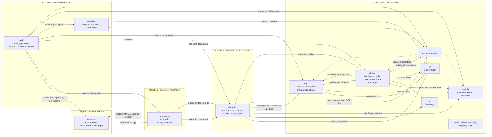
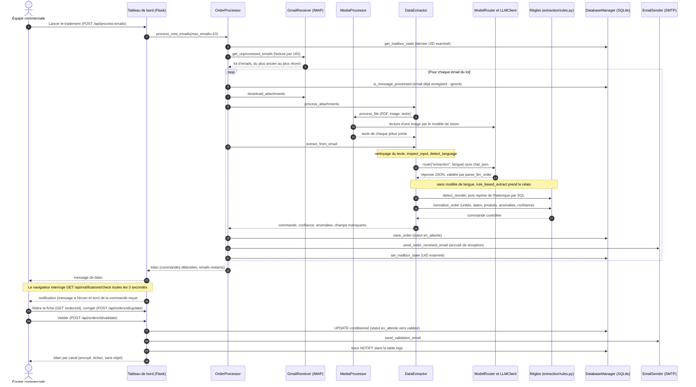
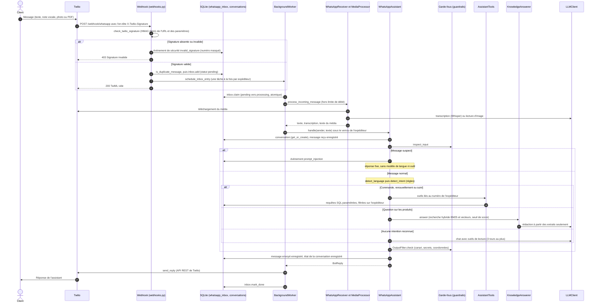
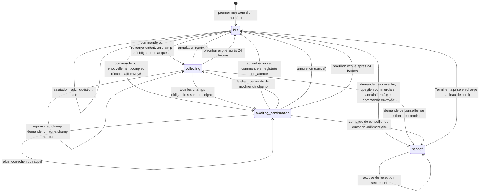
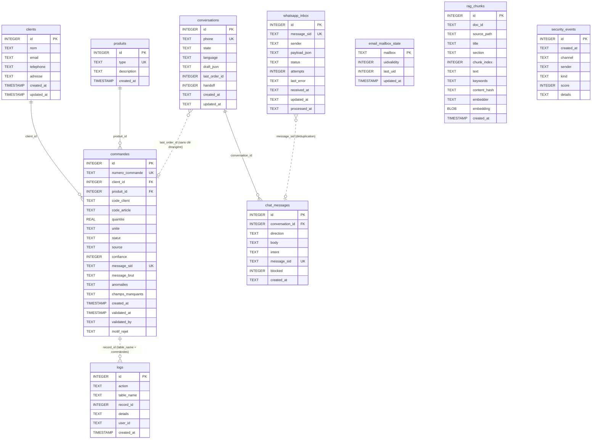
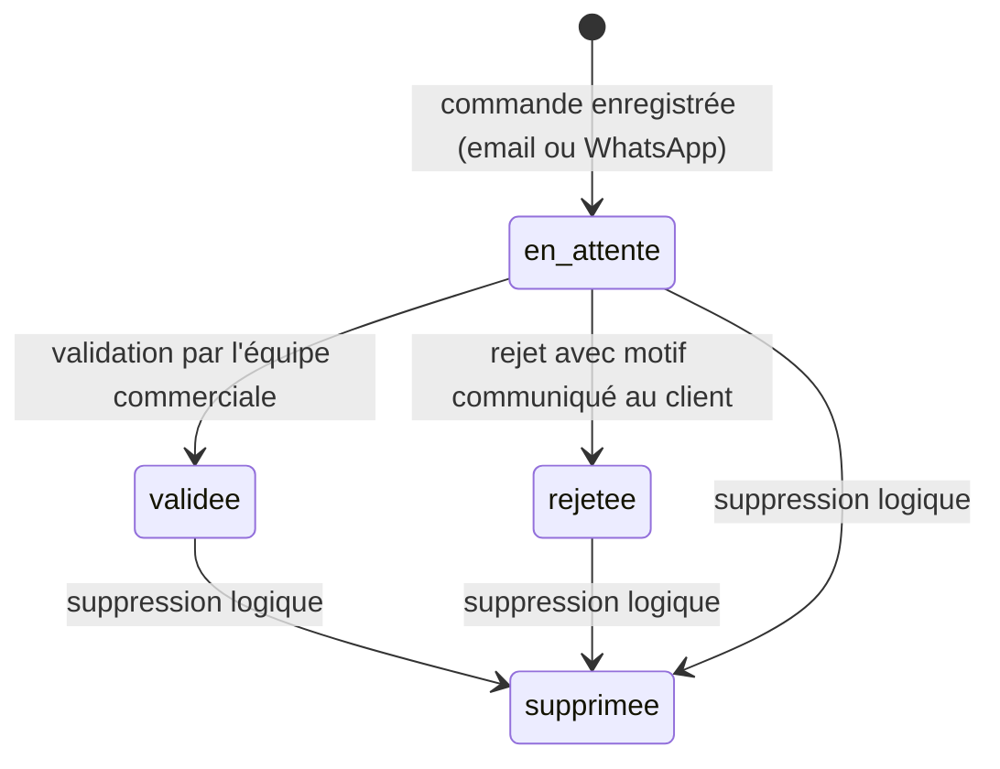

# Architecture de TECPAP

Ce document décrit l'organisation du code de TECPAP (version 3.0.0) : les quatre couches de traitement, les composants transversaux, les flux de bout en bout, le modèle de données, la gestion des fils d'exécution, la configuration et le traitement des erreurs. Les routes HTTP sont détaillées dans [api.md](api.md). Les autres documents approfondissent un sujet : [assistant_whatsapp.md](assistant_whatsapp.md), [rag.md](rag.md), [securite.md](securite.md), [choix_des_modeles.md](choix_des_modeles.md), [deploiement.md](deploiement.md) et [presentation_projet.md](presentation_projet.md). Le point de départ du dépôt est le [README](../README.md).

TECPAP reçoit des commandes de sacs en papier kraft par email (texte, PDF, images en pièce jointe) et par WhatsApp (texte, notes vocales, photos, PDF), en français, en darija (arabe marocain, écrit en lettres arabes ou en lettres latines avec des chiffres, dite « arabizi ») et en arabe standard. Le système extrait chaque commande, la prépare pour l'ERP SAGE X3 (progiciel de gestion intégré de l'entreprise) et la soumet à la validation de l'équipe commerciale.

**Principe directeur.** Un modèle de langue (LLM, *Large Language Model*) n'est jamais la seule source de vérité. Trois garanties se cumulent :

1. des règles déterministes (sans réseau ni modèle) lisent, normalisent et contrôlent chaque commande ;
2. les autorisations sont vérifiées dans le code, pas dans les consignes données au modèle ;
3. une commande reste « en attente » jusqu'à la validation de l'équipe commerciale.

## 1. Les quatre couches et les composants transversaux

| Couche | Rôle | Paquets et modules |
|---|---|---|
| 1. Canaux d'entrée | Recevoir les messages | `channels` (email IMAP, SMTP, WhatsApp Twilio), `web/routes/webhooks.py` (webhook signé) |
| 2. Traitement multimodal | Convertir tout contenu en texte | `processing/multimodal.py` : PDF, image, audio, texte |
| 3. Extraction par IA encadrée par des règles | Produire une commande contrôlée | `extraction` (extracteur, règles, schéma), `llm` (appels aux modèles) |
| 4. Validation humaine | Relire, corriger, valider ou rejeter | `web` (tableau de bord Flask), `reporting` (exports), notifications email et WhatsApp |

Les composants transversaux servent plusieurs couches :

| Composant | Rôle | Paquet |
|---|---|---|
| Assistant WhatsApp | Machine à états, intentions déterministes, outils liés au numéro de l'expéditeur | `chatbot` |
| Base de connaissances | Recherche dans des documents Markdown, génération augmentée par la recherche (RAG, *Retrieval-Augmented Generation*) | `rag` |
| Garde-fous de sécurité | Détection d'injections d'instructions, filtre de sortie, masquage, journal des événements | `security` |
| Choix du modèle selon la langue | Modèle principal ou léger selon la tâche et la langue | `llm/router.py` |
| Persistance | Base SQLite, sauvegardes | `db` |
| Langue | Détection de la langue et de l'écriture d'un message | `nlp` |
| Socle | Configuration, catalogue des produits, mise en forme, journal | `config.py`, `catalog.py`, `formatting.py`, `logging_config.py` |
| Évaluation hors ligne | Mesure de la couche déterministe (règles, langue, intentions, détecteur d'injection) | `evaluation/run_eval.py` |

L'évaluation hors ligne mesure la couche déterministe, pas le modèle de langue : son mode `--online` existe mais n'a pas été exécuté. Le protocole est décrit dans [evaluation/README.md](../evaluation/README.md) ; les rapports se trouvent dans `evaluation/results/`.

## 2. Vue des composants du paquet `tecpap/`

Chaque boîte est un sous-paquet. Une flèche signifie « importe ou appelle » pour un usage qui compte. Les créations de tables par `db` sont des imports différés (au moment de l'initialisation de la base), représentés en pointillés.

Tous les paquets lisent la configuration (`config`) et le catalogue (`catalog`) ; ces flèches ne sont pas dessinées. Le paquet `security` ne dépend que du catalogue.

## 3. Parcours d'une commande reçue par email

Le traitement des emails est lancé à la demande, depuis le bouton de la page `/process` (route `POST /api/process-emails`) ou par la ligne de commande (`scripts/process_emails.py`). Aucune tâche périodique ne lit la boîte.

Points à retenir :

- **Position de lecture.** La boîte est lue par UID (identifiant stable d'un message dans un dossier IMAP, valable tant que la valeur UIDVALIDITY du dossier ne change pas). La position (table `email_mailbox_state`) n'avance que si l'enregistrement a réussi.
- **Doublons.** Un email déjà enregistré (même en-tête `Message-ID`, ou à défaut même empreinte SHA-256 de l'expéditeur, de la date, du sujet et du corps) est écarté avant tout appel au modèle.
- **Accusé de réception.** Il ne reprend que des valeurs contrôlées (référence « CMD-<id> », produit du catalogue, quantité, unité reconnue). Il n'est pas envoyé pour une commande déjà enregistrée, un contenu suspect ou un email dont le contrôle DMARC (authentification du domaine de l'expéditeur) a échoué.
- **Validation.** Seule une commande « en attente » peut être validée ou rejetée. Une seconde décision sur la même commande reçoit une erreur 409 et ne déclenche aucun message au client.
- **Commande reçue par WhatsApp.** La même validation prévient aussi le client par WhatsApp, dans la langue de sa conversation.

## 4. Parcours d'un message WhatsApp

Points à retenir :

- **Réponse rapide.** Twilio attend la réponse du webhook au plus 15 secondes. Avec `WHATSAPP_ASYNC_REPLY` (actif par défaut), le webhook enregistre le message, répond aussitôt par un TwiML vide (format XML de Twilio, ici sans message) et la réponse part ensuite par l'API REST. Sans cette option, la réponse est renvoyée dans le TwiML de la requête.
- **File durable.** Le message est écrit dans `whatsapp_inbox` avant la réponse à Twilio. Un arrêt du processus pendant le traitement ne le perd pas : la maintenance périodique le reprend (voir la section 8).
- **Limite de débit.** Le contrôle (`WHATSAPP_RATE_LIMIT_PER_MINUTE`) a lieu avant le téléchargement du média, qui est payant (transcription, lecture d'image).
- **Ordre des messages.** Un expéditeur n'a qu'une tâche de fond à la fois : ses messages sont traités dans l'ordre d'arrivée.
- **Transfert à un conseiller.** Une demande de conseiller, une question commerciale (prix, délais, stock) ou l'annulation d'une commande déjà envoyée met la conversation à l'état `handoff`.
- **Sans assistant.** Avec `CHATBOT_ENABLED=false`, le message passe par une extraction en une fois : commande enregistrée « en attente » s'il s'agit d'un bon de commande, sinon réponse fixe.

## 5. États d'une conversation

L'état est enregistré dans la table `conversations` (colonne `state`) ; les valeurs possibles sont énumérées dans `STATES`, dans `tecpap/chatbot/conversation.py`.

- **Accord explicite.** Seul un accord clair (« oui », « wakha », « نعم ») enregistre la commande, toujours au statut « en_attente ».
- **Expiration.** Un brouillon qui n'est ni modifié ni confirmé pendant `DRAFT_TTL_HOURS` heures (24) est supprimé à la lecture suivante de la conversation (`ConversationStore.get_or_create`) ou par `ConversationStore.reset_after`. L'expiration ne change pas l'état d'une conversation transférée.
- **Sortie du transfert.** Seul le bouton « Terminer la prise en charge » de la fiche de conversation (route `POST /conversations/<id>/reset`) remet l'état à `idle`. Tant que l'état est `handoff`, l'assistant n'envoie qu'un accusé de réception.

## 6. Modèle de données

La base est un fichier SQLite unique (`DATABASE_PATH`). `DatabaseManager.init_database` crée les tables de commandes ; les tables de l'assistant, de la base de connaissances et du journal de sécurité sont créées par les fonctions `ensure_schema` de leurs modules, appelées depuis `init_database`. La table de la file durable est créée au démarrage par `Services.from_settings`. Toutes les dates sont en UTC, au format « AAAA-MM-JJ HH:MM:SS » ; la conversion en heure de Casablanca se fait à l'affichage.

Le diagramme ne montre que les colonnes d'identité, de liaison, de statut et de traçabilité de la table `commandes`, qui compte 46 colonnes. Le tableau suivant les regroupe toutes.

| Groupe de la table `commandes` | Colonnes |
|---|---|
| Identité | `id`, `numero_commande`, `ligne_commande`, `site_vente` |
| Liaisons | `client_id`, `produit_id`, `code_client`, `code_article` |
| Produit commandé | `nature_produit`, `type_sac`, `format_sac`, `type_papier`, `grammage`, `laize`, `impression_client` |
| Quantités | `quantite`, `unite`, `quantite_livree`, `reste_a_livrer`, `quantite_facturee` |
| Prix | `prix_unitaire`, `prix_total`, `devise` |
| Dates et commercial | `date_commande`, `date_livraison`, `commercial` |
| Origine | `source`, `email_id`, `email_subject`, `email_from`, `whatsapp_from` |
| Statut et validation | `statut`, `confiance`, `validated_at`, `validated_by`, `motif_rejet`, `created_at`, `updated_at` |
| Traçabilité de l'extraction | `message_sid`, `message_brut`, `langue`, `modele_llm`, `routage_modele`, `anomalies`, `champs_manquants` |
| Remarques | `informations_supplementaires` |

Rôle de chaque table :

| Table | Rôle | Module |
|---|---|---|
| `clients` | Clients, avec email et téléphone | `tecpap/db/database.py` |
| `produits` | Catalogue des produits, inséré depuis `tecpap/catalog.py` | `tecpap/db/database.py` |
| `commandes` | Commandes au format SAGE X3 et leur traçabilité | `tecpap/db/database.py` |
| `logs` | Journal des actions sur les données (création, modification, notification) | `tecpap/db/database.py` |
| `email_mailbox_state` | Position de lecture de la boîte IMAP | `tecpap/db/database.py` |
| `conversations` | Une ligne par numéro WhatsApp : état, langue, brouillon en JSON | `tecpap/chatbot/conversation.py` |
| `chat_messages` | Messages reçus et envoyés, avec l'intention reconnue | `tecpap/chatbot/conversation.py` |
| `whatsapp_inbox` | File durable des messages WhatsApp reçus | `tecpap/chatbot/inbox.py` |
| `rag_chunks` | Extraits de la base de connaissances et leurs vecteurs | `tecpap/rag/store.py` |
| `security_events` | Événements de sécurité, expéditeur masqué | `tecpap/security/events.py` |

Contraintes qui portent la cohérence :

- `commandes.message_sid` est unique (index partiel, valeurs non nulles) : un message ne crée qu'une commande. Il vaut l'identifiant Twilio d'un message WhatsApp ou l'identifiant d'un email.
- `chat_messages.message_sid` est unique : un message livré deux fois par Twilio n'est traité qu'une fois. La colonne `direction` est limitée à `in` ou `out`.
- `whatsapp_inbox.status` est limité à `pending`, `processing`, `done` ou `failed` ; `message_sid` y est unique.
- `rag_chunks` contient un couple (`doc_id`, `chunk_index`) unique.
- Le statut d'une commande (`ORDER_STATUSES`) vaut `en_attente`, `validee`, `rejetee` ou `supprimee` (suppression logique).

La suppression logique (`DatabaseManager.delete_order`) n'est appelée par aucune route du tableau de bord. Seules les commandes validées entrent dans l'export SAGE X3.

## 7. Modules

Les points d'entrée sont les noms à appeler ou à lire en premier.

### 7.1 Socle (`tecpap/`)

| Module | Rôle | Points d'entrée |
|---|---|---|
| `tecpap/__init__.py` | Déclare la version du paquet. | `__version__` |
| `tecpap/config.py` | Lit la configuration. | `load_settings`, `Settings`, `Settings.for_tests`, `ConfigurationError` |
| `tecpap/catalog.py` | Regroupe les données métier fixes. | `PRODUCTS`, `COMPANY_INFO`, `get_product_by_type` |
| `tecpap/formatting.py` | Met en forme nombres, montants et dates à la française. | `format_quantity`, `format_amount`, `format_datetime` |
| `tecpap/logging_config.py` | Installe le journal standard. | `configure_logging` |

### 7.2 Canaux d'entrée (`tecpap/channels/`)

| Module | Rôle | Points d'entrée |
|---|---|---|
| `email_receiver.py` | Lit la boîte Gmail par IMAP, par UID. | `GmailReceiver.get_unprocessed_emails`, `GmailReceiver.download_attachments` |
| `email_sender.py` | Envoie les emails par SMTP. | `EmailSender.send_order_received_email`, `EmailSender.send_validation_email`, `EmailSender.send_rejection_email` |
| `whatsapp.py` | Lit les messages Twilio, télécharge les médias, envoie les réponses. | `WhatsAppReceiver.process_incoming_message`, `WhatsAppReceiver.send_reply` |

### 7.3 Traitement multimodal (`tecpap/processing/`)

| Module | Rôle | Points d'entrée |
|---|---|---|
| `multimodal.py` | Convertit PDF, images, notes vocales et fichiers texte en texte. | `MediaProcessor.process_file`, `MediaProcessor.pdf_to_text`, `MediaProcessor.image_to_text`, `MediaProcessor.audio_to_text`, `MediaText` |
| `order_processor.py` | Orchestre la lecture de la boîte, l'extraction et l'enregistrement. | `OrderProcessor.process_new_emails`, `ProcessingAlreadyRunning` |

### 7.4 Extraction (`tecpap/extraction/`)

| Module | Rôle | Points d'entrée |
|---|---|---|
| `extractor.py` | Enchaîne contrôle des entrées, modèle, règles et historique. | `DataExtractor.extract_from_email`, `DataExtractor.extract_text`, `DataExtractor.assistant_extractor` |
| `rules.py` | Lit, normalise et contrôle les commandes sans réseau ni modèle. | `normalize_order`, `rule_based_extract`, `detect_reorder`, `parse_quantity`, `normalize_phone` |
| `schema.py` | Valide la réponse JSON du modèle avec pydantic. | `parse_llm_order`, `ExtractedOrder` |
| `prompts.py` | Rédige les consignes envoyées aux modèles. | `build_extraction_prompt`, `build_reorder_prompt`, `build_priority_prompt` |
| `article_codes.py` | Calcule les codes articles au format SAGE X3. | `generate_article_code`, `parse_article_code`, `suggest_article_code_from_description` |

### 7.5 Modèles de langue (`tecpap/llm/`) et langue (`tecpap/nlp/`)

| Module | Rôle | Points d'entrée |
|---|---|---|
| `llm/client.py` | Appelle l'API OpenAI. C'est le seul module qui importe son SDK. | `LLMClient.from_settings`, `LLMClient.chat_json`, `LLMClient.chat`, `LLMClient.transcribe`, `LLMClient.image_to_text`, `LLMClient.embed` |
| `llm/router.py` | Choisit le modèle selon la tâche et la langue. | `ModelRouter.route`, `ModelChoice` |
| `nlp/language.py` | Détecte la langue et l'écriture d'un message, sans modèle. | `detect_language`, `reply_language`, `message_body`, `LanguageResult` |

### 7.6 Base de connaissances (`tecpap/rag/`)

| Module | Rôle | Points d'entrée |
|---|---|---|
| `documents.py` | Lit les documents Markdown et les découpe en extraits. | `load_chunks`, `load_documents`, `parse_document`, `Chunk` |
| `text.py` | Normalise les textes (français, arabe, darija, arabizi). | `normalize_text`, `rewrite_arabizi`, `tokenize` |
| `embeddings.py` | Calcule les vecteurs, en local ou par OpenAI. | `LocalHashEmbedder`, `OpenAIEmbedder` |
| `bm25.py` | Score de recherche par mots-clés (Okapi BM25, fonction de pertinence classique). | `BM25Index` |
| `store.py` | Stocke extraits et vecteurs dans `rag_chunks`. | `ChunkStore`, `ensure_schema` |
| `retriever.py` | Indexe et cherche (fusion par rangs réciproques, RRF), choisit des exemples de commandes. | `KnowledgeBase.index`, `KnowledgeBase.search`, `build_embedder`, `OrderExampleRetriever`, `best_score`, `reciprocal_rank_fusion` |
| `answer.py` | Répond aux questions à partir des extraits seulement. | `KnowledgeAnswerer.answer`, `is_commercial_question`, `Answer` |
| `calibration.py` | Mesure la séparation des questions et choisit le seuil. | `separation_report`, `best_threshold`, `load_labelled_queries` |

### 7.7 Assistant WhatsApp (`tecpap/chatbot/`)

| Module | Rôle | Points d'entrée |
|---|---|---|
| `bot.py` | Automate de conversation. | `WhatsAppAssistant.handle`, `BotReply` |
| `intents.py` | Reconnaît l'intention d'un message par règles. | `detect_intent`, `IntentResult` |
| `messages.py` | Fournit les modèles de réponse en français, darija et arabe. | `render`, `order_lines`, `status_lines`, `product_menu` |
| `tools.py` | Donne à l'assistant son seul accès aux données, limité à l'expéditeur. | `AssistantTools`, `TOOL_NAMES`, `ToolResult` |
| `conversation.py` | Enregistre l'état des conversations et leurs messages. | `ConversationStore`, `Conversation`, `STATES`, `conversation_key` |
| `inbox.py` | Gère la file durable des messages reçus. | `WhatsAppInbox`, `InboxEntry`, `STATUSES` |

### 7.8 Sécurité (`tecpap/security/`)

| Module | Rôle | Points d'entrée |
|---|---|---|
| `guardrails.py` | Contrôle les entrées, délimite le contenu externe, filtre les sorties. | `inspect_input`, `wrap_untrusted`, `new_canary`, `OutputFilter` |
| `signals.py` | Définit les signaux pondérés de la détection d'injection. | `Signal`, `Bonus` |
| `text.py` | Nettoie et normalise les textes pour la détection. | `sanitize_text`, `build_views`, `normalize_for_matching` |
| `redaction.py` | Repère et masque numéros de téléphone et emails. | `mask_sender`, `redact_contacts`, `find_phone_numbers` |
| `events.py` | Enregistre les événements de sécurité. | `log_security_event`, `recent_security_events`, `count_security_events`, `purge_security_events`, `EventThrottle` |

### 7.9 Base de données (`tecpap/db/`)

| Module | Rôle | Points d'entrée |
|---|---|---|
| `database.py` | Accède à SQLite, une connexion par fil. | `DatabaseManager`, `clean_order_updates`, `ORDER_UPDATABLE_FIELDS`, `ORDER_STATUSES`, `migrate_schema`, `close_connections_to` |
| `backup.py` | Sauvegarde, restaure et exporte la base. | `create_backup`, `restore_backup`, `list_backups`, `delete_old_backups`, `export_to_json` |

### 7.10 Rapports (`tecpap/reporting/`)

| Module | Rôle | Points d'entrée |
|---|---|---|
| `analytics.py` | Calcule statistiques, alertes et prévisions, et produit les exports. | `Analytics.get_dashboard_stats`, `AlertSystem.check_alerts`, `ClientHistory`, `AIPredictor`, `ReportGenerator` |
| `pdf_report.py` | Compose le rapport PDF. | `generate_pdf_report_improved` |
| `spreadsheet.py` | Protège les exports contre l'injection de formules. | `neutralize_csv_value`, `protect_text_cells`, `unique_export_path` |

### 7.11 Application web (`tecpap/web/`)

| Module | Rôle | Points d'entrée |
|---|---|---|
| `__init__.py` | Construit l'application Flask. | `create_app`, `BLUEPRINTS`, `MAX_REQUEST_BYTES` |
| `auth.py` | Gère la connexion, la session, la limitation des essais et le jeton CSRF. | `init_auth`, `LoginRateLimiter`, `LoginDelayLimiter`, `verify_credentials`, `csrf_token` |
| `errors.py` | Formate les réponses d'erreur. | `json_error`, `server_error`, `error_page`, `register_error_handlers` |
| `security_headers.py` | Ajoute les en-têtes de sécurité. | `init_security_headers`, `CONTENT_SECURITY_POLICY` |
| `services.py` | Construit et partage les services. | `Services.from_settings`, `get_services` |
| `worker.py` | Exécute les tâches de fond et les tâches périodiques. | `BackgroundWorker`, `PeriodicTask` |
| `scheduler.py` | Planifie les sauvegardes automatiques. | `BackupScheduler`, `SchedulerConfigError` |
| `routes/auth_routes.py` | Connexion et déconnexion. | `login`, `logout` |
| `routes/pages.py` | Pages HTML du tableau de bord. | `index`, `orders_list`, `order_detail`, `clients_page`, `sage_export_page` |
| `routes/assistant.py` | Conversations, base de connaissances, sécurité. | `conversations`, `knowledge`, `security` |
| `routes/api.py` | API JSON : validation, rejet, modification, statistiques. | `api_validate_order`, `api_reject_order`, `api_process_emails`, `healthz` |
| `routes/webhooks.py` | Webhook WhatsApp et reprise des messages en attente. | `whatsapp_webhook`, `check_twilio_signature`, `resume_pending_messages` |
| `routes/backups.py` | Page et API des sauvegardes. | `backups_page`, `api_create_backup`, `api_restore_backup` |
| `routes/exports.py` | Téléchargement des exports. | `export_excel`, `export_excel_sage`, `export_csv`, `export_pdf` |
| `templates/` | Gabarits Jinja (19 fichiers HTML), hérités de `base.html`. | `base.html`, `error.html` |

### 7.12 Hors du paquet

| Élément | Rôle | Point d'entrée |
|---|---|---|
| `app.py` | Expose l'application WSGI (interface standard entre serveur web et application Python). | `app` |
| `scripts/process_emails.py` | Traite les emails depuis la ligne de commande. | `python scripts/process_emails.py` |
| `scripts/backup.py` | Sauvegarde, liste, restaure, nettoie, exporte. | `python scripts/backup.py backup` |
| `scripts/build_knowledge_index.py` | Construit l'index de la base de connaissances. | `python scripts/build_knowledge_index.py` |
| `scripts/hash_password.py` | Calcule l'empreinte du mot de passe administrateur. | `python scripts/hash_password.py` |
| `scripts/rename_generic_clients.py` | Renomme les clients à nom provisoire. | `python scripts/rename_generic_clients.py` |
| `evaluation/run_eval.py` | Évalue la couche déterministe sur le corpus annoté. | `python evaluation/run_eval.py` |
| `knowledge/` | Documents Markdown de la base de connaissances. | `KNOWLEDGE_DIR` |
| `tests/` | Tests automatisés (pytest). | `python -m pytest` |
| `Dockerfile` | Image de production (gunicorn). | `docker build` |

## 8. Modèle de concurrence

L'application est un seul processus gunicorn de 4 fils d'exécution (`--workers 1 --threads 4`, délai de 120 secondes, voir le `Dockerfile`). Un seul processus est nécessaire parce que plusieurs mécanismes gardent leur état en mémoire : planificateur de sauvegardes, tâches de fond, verrous par expéditeur, liste des messages en cours, compteurs d'échecs de connexion, limite des événements de signature. Plusieurs processus lanceraient chacun les sauvegardes et le traitement des messages, et ne partageraient pas ces compteurs.

### 8.1 Une connexion SQLite par fil

`DatabaseManager` ne partage jamais une connexion entre deux fils : l'état de chaque fil est un objet `threading.local`, et la propriété `connection` ouvre la connexion du fil à la première utilisation. Les réglages communs :

- mode WAL (*write-ahead logging*, journal à écriture anticipée) : les lectures se poursuivent pendant une écriture ;
- attente de 30 secondes (`busy_timeout`) quand la base est verrouillée par une autre connexion : les écritures se font l'une après l'autre ;
- `check_same_thread=False` sert uniquement à `close_all`, qui ferme les connexions des autres fils à l'arrêt ou avant une restauration ;
- les connexions des fils terminés sont fermées à l'ouverture suivante.

Les objets qui s'appuient sur une connexion (`ConversationStore`, `WhatsAppInbox`, `KnowledgeBase`, `WhatsAppAssistant`) sont construits à la demande, sur la connexion du fil courant, par `Services.conversation_store`, `Services.inbox`, `Services.knowledge_base` et `Services.assistant`. La base de connaissances est gardée une fois par fil.

La restauration d'une sauvegarde (`restore_backup`) ferme d'abord toutes les connexions de tous les gestionnaires ouverts sur la base (`close_connections_to`) ; chaque fil rouvre la sienne au prochain accès. Une requête web rouvre aussi la connexion si elle a été fermée (fonction `ensure_database_connection` de `create_app`).

### 8.2 Fils et verrous

| Élément | Nombre | Rôle | Où |
|---|---|---|---|
| Fils de gunicorn | 4 | Servent les requêtes HTTP | `Dockerfile` |
| `BackgroundWorker` | 2 fils, 100 tâches au plus (en attente ou en cours) | Traite les messages WhatsApp en différé | `tecpap/web/worker.py` |
| `PeriodicTask` « tecpap-maintenance » | 1 fil démon | Reprend les messages en attente, purge les journaux | `tecpap/web/services.py` |
| `BackupScheduler` « backup-scheduler » | 1 fil démon | Lance les sauvegardes automatiques | `tecpap/web/scheduler.py` |

| Verrou | Portée | Effet |
|---|---|---|
| `Services.sender_lock` | 64 verrous répartis par numéro d'expéditeur | Les messages d'un même numéro se traitent l'un après l'autre, quel que soit le fil. La remise à zéro d'une conversation attend ce verrou. |
| `MAX_TASKS_PER_SENDER` (1) | Tâches de fond par expéditeur | Une rafale venue d'un numéro n'occupe pas toute la file ; l'ordre d'arrivée est gardé. |
| `WhatsAppInbox.claim` | Ligne de la file | Prise en charge atomique : deux fils ne traitent jamais le même message. |
| `_RUN_LOCK` (`order_processor.py`) | Processus | Un seul traitement des emails à la fois ; un second appel reçoit l'erreur 409. |
| `BoundedSemaphore` (`BackgroundWorker`) | 100 places | Au-delà, la tâche est refusée : le message reste dans la file durable. |

### 8.3 Tâches périodiques

- **Maintenance.** Une première exécution 5 secondes après le démarrage remet en attente les messages pris en charge avant le démarrage du processus (traitement interrompu par l'arrêt précédent), puis soumet les messages en attente. Les exécutions suivantes ont lieu toutes les 60 secondes ; un message resté « pris en charge » depuis plus de 15 minutes est alors considéré comme interrompu. Au plus une fois par heure, la maintenance purge les événements de sécurité anciens et les messages traités de la file.
- **Sauvegardes.** Elles ont lieu aux heures rondes multiples de `BACKUP_INTERVAL_HOURS` (6 par défaut), et seules les `BACKUP_KEEP` plus récentes sont conservées (20 par défaut).
- **Mode débogage.** Le rechargeur de Werkzeug lance deux processus : seul le processus enfant démarre les tâches périodiques (`should_start_in_this_process`). Le mode débogage est refusé en production.

### 8.4 Arrêt

En dehors des tests, `create_app` enregistre `Services.close` auprès de `atexit`. L'arrêt (signal SIGTERM de gunicorn ou de `docker stop`) arrête la maintenance, attend la fin des tâches de fond (`BackgroundWorker.shutdown(wait=True)`), arrête le planificateur de sauvegardes et ferme toutes les connexions. Un message dont le traitement est coupé reste dans la file durable et est repris au démarrage suivant. Le délai d'arrêt de Docker (`--stop-timeout 130`) dépasse le délai de grâce de gunicorn (120 secondes).

## 9. Configuration

Toute la configuration est lue une seule fois par `load_settings` (variables d'environnement et fichier `.env`) et transmise sous la forme d'un objet `Settings` immuable. Aucun module métier ne lit `os.environ` : les tests construisent une configuration complète avec `Settings.for_tests(dossier)`, qui isole tous les chemins, supprime les clés d'API et désactive l'authentification, la protection CSRF, la vérification de signature, le planificateur de sauvegardes et la réponse WhatsApp différée.

Règles de lecture :

- une variable absente ou vide garde sa valeur par défaut ;
- une valeur d'exemple de `.env.example` laissée en place (clé d'API, jeton, mot de passe, adresse publique) est ignorée avec un avertissement : le service correspondant reste désactivé ;
- une valeur invalide lève `ConfigurationError` au démarrage ;
- en production (`APP_ENV=production`), `SECRET_KEY` est obligatoire (32 caractères au moins) et le mode débogage est refusé ;
- hors production, une clé de session aléatoire est tirée pour la durée du processus.

| Groupe | Variables |
|---|---|
| Application | `APP_ENV`, `SECRET_KEY`, `FLASK_HOST`, `FLASK_PORT`, `FLASK_DEBUG`, `APP_TIMEZONE`, `LOG_LEVEL` |
| Dossiers et fichiers | `DATABASE_PATH`, `BACKUP_DIR`, `EXPORT_DIR`, `ATTACHMENTS_DIR`, `WHATSAPP_MEDIA_DIR`, `KNOWLEDGE_DIR` |
| Modèles de langue | `OPENAI_API_KEY`, `LLM_MODEL_EXTRACTION`, `LLM_MODEL_LIGHT`, `LLM_MODEL_VISION`, `TRANSCRIPTION_MODEL`, `TRANSCRIPTION_LANGUAGE`, `EMBEDDING_MODEL`, `LLM_TEMPERATURE`, `LLM_TIMEOUT` |
| Email | `GMAIL_EMAIL`, `GMAIL_APP_PASSWORD`, `SMTP_SERVER`, `SMTP_PORT` |
| WhatsApp | `TWILIO_ACCOUNT_SID`, `TWILIO_AUTH_TOKEN`, `TWILIO_WHATSAPP_NUMBER`, `TWILIO_VALIDATE_SIGNATURE`, `PUBLIC_BASE_URL`, `WHATSAPP_ASYNC_REPLY`, `WHATSAPP_RATE_LIMIT_PER_MINUTE`, `MAX_MEDIA_BYTES` |
| Assistant et base de connaissances | `CHATBOT_ENABLED`, `RAG_ENABLED`, `RAG_TOP_K`, `RAG_MIN_SCORE`, `RAG_EMBEDDER` |
| Accès au tableau de bord | `AUTH_ENABLED`, `ADMIN_USERNAME`, `ADMIN_PASSWORD_HASH`, `CSRF_ENABLED`, `LOGIN_MAX_ATTEMPTS`, `LOGIN_LOCKOUT_MINUTES`, `SESSION_COOKIE_SECURE`, `TRUST_PROXY_HEADERS` |
| Sauvegardes | `BACKUP_SCHEDULER_ENABLED`, `BACKUP_INTERVAL_HOURS`, `BACKUP_KEEP` |

Le rôle et la valeur par défaut de chaque variable sont décrits dans `.env.example`. Les conséquences d'une valeur manquante :

| Variable absente | Effet |
|---|---|
| `OPENAI_API_KEY` | Extraction par règles seules (anomalie signalée, confiance plafonnée), pas de transcription ni de lecture d'image, plongements calculés en local |
| `GMAIL_EMAIL` ou `GMAIL_APP_PASSWORD` | Traitement des emails impossible (erreur 502 sur `POST /api/process-emails`) |
| `TWILIO_ACCOUNT_SID` ou `TWILIO_AUTH_TOKEN` | Envoi WhatsApp impossible ; avec la vérification de signature active, le webhook répond 503 |
| `ADMIN_PASSWORD_HASH` | Aucune connexion possible au tableau de bord |
| `SECRET_KEY` | Refus de démarrer en production |

La politique de choix des modèles est décrite dans [choix_des_modeles.md](choix_des_modeles.md), le déploiement dans [deploiement.md](deploiement.md).

## 10. Gestion des erreurs et journalisation

### 10.1 Principes

- **Aucune exception technique n'atteint l'utilisateur.** Les routes consignent l'exception dans le journal (`logger.exception`) et répondent par un message générique (`GENERIC_ERROR_MESSAGE`). Seuls les messages de validation écrits pour l'utilisateur sont renvoyés tels quels.
- **Un composant qui échoue ne bloque pas la chaîne.** Les composants de bas niveau ne lèvent pas d'exception vers leur appelant : ils renvoient une valeur d'échec.
- **Un repli déterministe existe quand le modèle manque.** L'extraction par règles prend le relais, et la commande arrive au tableau de bord avec une anomalie qui demande une relecture complète.

### 10.2 Comportement par situation

| Situation | Comportement | Où |
|---|---|---|
| Erreur inattendue dans une route JSON | Réponse 500 au message générique, détail dans le journal | `server_error` dans `tecpap/web/errors.py` |
| Erreur HTTP non traitée par une route (400, 404, 405, 413, 500) | JSON sous `/api/`, page HTML ailleurs | `register_error_handlers` |
| Corps de requête de plus de 1 Mo | Réponse 413 avant toute lecture | `MAX_REQUEST_BYTES` |
| Session absente | Redirection vers `/login` (pages) ou réponse 401 JSON (API) | `init_auth` |
| Jeton CSRF absent ou invalide | Réponse 403 | `init_auth` |
| Appel au modèle en échec | Un seul nouvel essai pour les erreurs passagères, puis `None` ; le contenu des messages n'est jamais journalisé | `LLMClient` |
| Réponse du modèle illisible ou modèle absent | Extraction par règles, anomalie `RULES_FALLBACK_ANOMALY`, confiance plafonnée à `RULES_MAX_CONFIDENCE` | `DataExtractor` |
| Média illisible ou trop volumineux | Champ `error` de `MediaText`, jamais d'exception ; message « media_failed » au client sans autre texte | `MediaProcessor` |
| Contenu suspect (injection d'instructions) | Commande conservée avec une anomalie ; assistant : réponse fixe sans modèle ni outil | `inspect_input` |
| Erreur pendant le traitement d'un email | Email ignoré et compté dans `failed_emails` ; les suivants sont traités | `OrderProcessor` |
| Erreur SQLite pendant un passage sur les emails | Passage arrêté, position de lecture inchangée : l'email est relu | `OrderProcessor` |
| Boîte Gmail injoignable | Réponse 502 | `api_process_emails` |
| Erreur pendant un message WhatsApp | Message d'erreur générique dans la langue du client, message de la file marqué `failed` | `process_inbox_entry` |
| Erreur dans l'assistant | État de la conversation relu, réponse « error » | `WhatsAppAssistant` |
| Envoi de réponse WhatsApp en échec | Consigné dans le journal et dans la file ; le message n'est pas retraité | `process_inbox_entry` |
| Notification de décision en échec | La décision reste enregistrée ; la réponse indique `failed` et un avertissement | `_notify_client` |
| Écriture d'un événement de sécurité en échec | Consigné, sans changer la réponse au client | `log_security_event` |
| Exception dans une tâche de fond ou périodique | Consignée, jamais propagée ; les exécutions suivantes continuent | `BackgroundWorker`, `PeriodicTask` |
| Configuration invalide | `ConfigurationError` au démarrage | `load_settings` |

### 10.3 Journalisation

- `configure_logging` installe un gestionnaire vers la sortie d'erreur et règle le niveau (`LOG_LEVEL`). Il n'est installé qu'une fois.
- Format d'une ligne : date, niveau, nom du fil, nom du module, message. Le nom du fil distingue les tâches de fond (préfixe `tecpap-tache`), la maintenance, les sauvegardes et les requêtes.
- Les journaux des bibliothèques Twilio, OpenAI et de leurs clients HTTP sont limités au niveau WARNING (sauf avec `LOG_LEVEL=DEBUG`) : leurs lignes d'appel contiennent l'identifiant du compte Twilio.
- Les numéros et adresses ne sont écrits que masqués (`mask_sender`) ; le texte des messages clients n'est pas écrit.
- Deux journaux sont aussi tenus en base : la table `logs` (actions sur les commandes et les clients, avec l'utilisateur connecté) et la table `security_events` (événements de sécurité visibles dans la page « Sécurité »).
- En production, gunicorn écrit en plus le journal d'accès sur la sortie standard (`--access-logfile -`).

## 11. Où sont appliquées les garanties

| Garantie | Mécanisme | Code |
|---|---|---|
| Le modèle n'a pas d'accès libre à la base | Fonctions SQL fixes et paramétrées, liées à l'expéditeur | `AssistantTools`, `DataExtractor.get_sender_last_order` |
| Un client ne voit que ses commandes | Filtre sur le numéro de l'expéditeur dans chaque requête, jamais sur un nom d'entreprise | `AssistantTools` |
| Une commande n'est jamais enregistrée sans accord | L'assistant n'enregistre qu'après un accord explicite, au statut « en_attente » | `WhatsAppAssistant._submit` |
| Aucun chiffre ne vient du modèle seul | Quantités, dates, unités, produits et confiance passent par les règles | `normalize_order` |
| Les réponses contenant des données viennent de modèles fixes | Récapitulatifs, statuts et confirmations sont remplis par le code | `tecpap/chatbot/messages.py` |
| Une fuite des consignes système est détectée | Jeton témoin (*canary token*, code aléatoire placé dans les consignes) et filtre de sortie | `new_canary`, `OutputFilter` |
| Seul Twilio peut créer une commande par le webhook | Signature HMAC-SHA1 vérifiée avant tout traitement | `check_twilio_signature` |
| Une commande est validée par un humain | Statut « en attente » jusqu'à la décision, validation conditionnelle en une requête SQL | `_decide` dans `tecpap/web/routes/api.py` |
| L'ERP ne reçoit que du contenu relu | L'export SAGE X3 ne contient que des commandes validées | `ReportGenerator.export_to_excel_sage` |

Le détail des contrôles de sécurité est dans [securite.md](securite.md).
