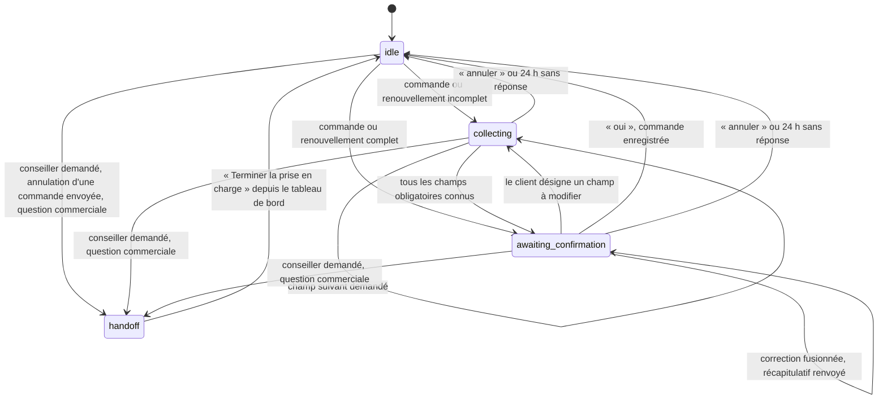

# Assistant WhatsApp

Ce document décrit l'assistant WhatsApp de TECPAP : son rôle, le déroulement d'une conversation, ses règles de décision, ses limites. Les autres documents : [architecture](architecture.md), [base de connaissances et recherche (RAG)](rag.md), [sécurité](securite.md), [choix des modèles](choix_des_modeles.md), [API et tableau de bord](api.md), [évaluation hors ligne](../evaluation/README.md).

## 1. Rôle

Les clients de TECPAP écrivent sur WhatsApp en français, en darija (arabe marocain, écrit en lettres latines avec des chiffres, ou en lettres arabes) et en arabe standard. L'assistant WhatsApp mène la conversation avec le client pour :

- compléter une commande (produit, quantité, nom de l'entreprise) puis la faire confirmer ;
- renouveler la dernière commande validée (« comme d'habitude », « kif dima », « كالعادة ») ;
- indiquer le statut des commandes envoyées depuis le même numéro ;
- répondre aux questions sur les produits, à partir de la [base de connaissances](rag.md) ;
- transférer la conversation à l'équipe commerciale (transfert à un conseiller, en anglais handoff).

Principe de conception : le modèle de langue (LLM, Large Language Model) n'est jamais la seule source de vérité. Les intentions sont reconnues par des règles, les données montrées au client viennent de modèles de réponse fixes remplis par le code, les accès aux données sont limités au numéro de l'expéditeur par le code (et non par des consignes données au modèle), et chaque commande est validée par l'équipe commerciale.

Le code se trouve dans `tecpap/chatbot/` : `bot.py` (machine à états), `intents.py` (intentions), `messages.py` (modèles de réponse), `tools.py` (outils), `conversation.py` (conversations enregistrées), `inbox.py` (file durable des messages reçus).

## 2. Traitement d'un message

Chaque message reçu passe par ces étapes, dans cet ordre.

1. **Réception par le webhook.** Twilio (service qui transporte les messages WhatsApp) appelle l'adresse `/webhook/whatsapp`. La signature de la requête est vérifiée ; une requête sans signature valide est refusée.
2. **Déduplication.** Un message dont l'identifiant Twilio (`MessageSid`) est déjà connu ne reçoit aucune réponse.
3. **Enregistrement dans la file durable.** Le message est écrit dans la table `whatsapp_inbox` avant tout traitement (voir la section 9).
4. **Contrôle préalable de la limite de débit** (section 10). Un expéditeur qui dépasse la limite ne déclenche ni transcription ni lecture d'image, qui sont payantes : seul le corps de son message est enregistré.
5. **Lecture du média.** Une note vocale est transcrite, une image est lue par un modèle de vision, le texte d'un PDF est extrait. Le texte analysé réunit le corps du message et ce qui a été lu dans le média.
6. **Traitement par l'assistant.** L'assistant contrôle de nouveau les doublons, puis applique la limite de débit : au-delà, il envoie un avertissement ou ne répond pas.
7. **Contrôle des injections d'instructions (prompt injection).** Un message qui cherche à détourner le modèle de langue est enregistré comme événement de sécurité et reçoit une réponse fixe, sans appel au modèle ni aux outils. Détails dans [sécurité](securite.md).
8. **Langue.** La conversation garde la dernière langue clairement détectée. Une réponse courte ou ambiguë (« ok », « 5000 ») ne la change pas ; un changement de langue exige une confiance de détection d'au moins 0,5.
9. **Intention déterministe** (section 5), puis **machine à états** (section 4).
10. **Réponse.** Elle vient d'un modèle de réponse fixe, de la base de connaissances ou, pour un message sans intention reconnue, du modèle de langue (section 6). Tout texte rédigé par un modèle passe par le filtre de sortie.
11. **Enregistrement et envoi.** Le message reçu et la réponse sont enregistrés dans la conversation, puis la réponse est envoyée.

Un message vide sans média reçoit la salutation. Un média illisible sans autre texte reçoit le message « je n'ai pas pu lire votre fichier ». Une erreur de traitement reçoit un message d'erreur générique dans la langue du client ; le détail reste dans le journal du serveur.

## 3. Exemples de conversations

Les échanges ci-dessous sont des sorties réelles de l'assistant, obtenues sans modèle de langue sur une base de test. Les numéros de téléphone sont fictifs. Les quantités sont écrites avec une espace fine entre les milliers, comme dans les messages envoyés.

### 3.1 Commande en français, avec correction

| Qui | Message |
|---|---|
| Client | Je voudrais commander des sacs |
| Assistant | Quel produit souhaitez-vous ? Répondez par le numéro : 1. Sachets fond plat (sandwichs, tacos, viennoiseries) 2. Sac fond carré sans poignées 3. Sac fond carré avec poignées plates 4. Sac fond carré avec poignées torsadées (sacs premium) |
| Client | 3 |
| Assistant | Quelle quantité souhaitez-vous (nombre de pièces) ? Par exemple : 5000. |
| Client | 5000 |
| Assistant | Pour quel commerce ou quelle entreprise est cette commande ? Indiquez son nom. |
| Client | Snack Atlas |
| Assistant | Récapitulatif de votre commande : Client : Snack Atlas ; Produit : Sac fond carré avec poignées plates ; Quantité : 5 000 pièces. Confirmez-vous ? Répondez OUI pour valider, NON pour modifier, ou ANNULER. |
| Client | 8000 |
| Assistant | *(le même récapitulatif, avec la quantité 8 000 pièces)* |
| Client | oui |
| Assistant | ✅ Merci ! Votre commande CMD-1 est enregistrée. Elle est en attente de validation par notre équipe commerciale. |

Seul l'accord explicite (« oui ») enregistre la commande. Elle est créée au statut « en attente » : l'équipe commerciale la valide ensuite depuis le tableau de bord.

### 3.2 Suivi et renouvellement en français

| Qui | Message |
|---|---|
| Client | où en est ma commande ? |
| Assistant | Vos dernières commandes : - CMD-1 (25/10/2026) : 8 000 pièces, Sac fond carré avec poignées plates — en attente de validation |
| Client | comme d'habitude *(après validation de CMD-1 par l'équipe commerciale)* |
| Assistant | Voici votre dernière commande validée, prête à être renouvelée. Récapitulatif de votre commande : Client : Snack Atlas ; Produit : Sac fond carré avec poignées plates ; Quantité : 8 000 pièces. Confirmez-vous ? Répondez OUI pour valider, NON pour modifier, ou ANNULER. |
| Client | oui |
| Assistant | ✅ Merci ! Votre commande CMD-2 est enregistrée. Elle est en attente de validation par notre équipe commerciale. |

Le renouvellement reprend la dernière commande validée envoyée depuis le même numéro. Une précision donnée dans le même message (une autre quantité, par exemple) remplace la valeur de cette commande.

### 3.3 Commande en darija (lettres latines)

| Qui | Message |
|---|---|
| Client | Salam |
| Assistant | Salam! Ana l'assistant WhatsApp dyal TECPAP. N9der n3awnek : tsift commande (produit w quantité), t3awed nafs la commande ("kif dima"), tchouf fin wslat commande dyalek, tswel 3la les sacs dyalna. Kteb "conseiller" bach tehder m3a l'équipe commerciale. |
| Client | bghit 3000 sachet dyal sandwich |
| Assistant | Chno smiyt l'commerce wla la société li 3endha had la commande? |
| Client | Boulangerie Nour |
| Assistant | Hak l'récap dyal la commande: Client: Boulangerie Nour ; Produit: Sachets fond plat ; Quantité: 3 000 7ba. Nconfirmiw? Kteb "wakha" bach tconfirmi, "la" bach tbeddel, wla "annuler". |
| Client | wakha |
| Assistant | ✅ Chokran! La commande CMD-3 tsejlat. Daba katsna l'validation dyal l'équipe commerciale. |

### 3.4 Commande en arabe standard

| Qui | Message |
|---|---|
| Client | السلام عليكم |
| Assistant | مرحبا! أنا المساعد الآلي لشركة TECPAP على واتساب. (suivi de la liste des services) |
| Client | أريد 2000 كيس بمقابض مسطحة لشركة الأمل |
| Assistant | ملخص طلبك: الزبون: شركة الأمل ؛ المنتج: كيس بقاع مربع بمقابض مسطحة ؛ الكمية: 2 000 قطعة. هل تؤكد الطلب؟ أجب بـ«نعم» للتأكيد، أو «لا» للتعديل، أو «إلغاء». |
| Client | نعم |
| Assistant | ✅ شكرا! تم تسجيل طلبك CMD-3، وهو الآن في انتظار مراجعة فريقنا التجاري. |

### 3.5 Transfert à un conseiller

| Qui | Message |
|---|---|
| Client | Quel est le prix des sachets ? |
| Assistant | Les prix, les délais et les disponibilités sont communiqués par notre équipe commerciale. Un conseiller vous répond ici rapidement. *(la conversation passe à l'état « handoff »)* |
| Client | ok |
| Assistant | Message bien reçu. Notre équipe commerciale vous répond ici rapidement. |

### 3.6 Question sans réponse dans la base, demande d'annulation

| Qui | Message |
|---|---|
| Client | Est-ce que vous livrez à Agadir le samedi ? |
| Assistant | Je n'ai pas cette information. Écrivez « conseiller » pour qu'un membre de notre équipe vous réponde. *(la conversation reste à l'état « idle » : aucun transfert automatique)* |
| Client | annulez ma commande *(sans commande en cours de saisie)* |
| Assistant | Votre demande d'annulation est transmise à notre équipe commerciale, qui vous la confirmera ici. *(la conversation passe à l'état « handoff »)* |

Tous les textes fixes existent dans les trois langues (`tecpap/chatbot/messages.py`). Un client qui écrit en anglais reçoit des réponses en français. Un client qui écrit la darija en lettres arabes reçoit des réponses en darija écrite en lettres latines.

## 4. États et transitions

La conversation de chaque numéro a un état, enregistré dans la table `conversations`.

| État | Signification |
|---|---|
| `idle` | Aucune commande en cours de saisie. |
| `collecting` | Commande en cours, un champ obligatoire manque. |
| `awaiting_confirmation` | Récapitulatif envoyé, accord explicite attendu. |
| `handoff` | Conversation transférée à l'équipe commerciale. |

Règles qui s'appliquent quel que soit l'état :

- Les champs obligatoires d'une commande sont le produit, la quantité et le nom de l'entreprise, demandés dans cet ordre. Si le client est connu (dernière commande validée depuis le même numéro), son nom est repris.
- Une question de suivi, une question sur les produits ou une salutation reçue pendant une commande en cours reçoit sa réponse, suivie du rappel de la question en attente.
- Un brouillon de commande non confirmé expire après 24 heures sans modification. Il est supprimé à la lecture suivante de la conversation et le client en est informé.
- En état `handoff`, l'assistant n'accuse plus que réception du message. Il ne reprend la main qu'après la remise à zéro depuis le tableau de bord (section 8).
- Une commande n'est créée que sur un accord explicite à l'état `awaiting_confirmation`. Un second « oui » ne crée pas une deuxième commande.
- Un message qui dit « non » demande ce qu'il faut modifier ; un message qui contient une correction (« 8000 », « c'est pour Snack X ») est fusionné dans la commande, puis le récapitulatif est renvoyé.

## 5. Intentions déterministes et priorité

Le module `tecpap/chatbot/intents.py` reconnaît l'intention d'un message sans modèle de langue, par mots-clés, familles d'expressions et formes verbales, en français, en anglais, en arabe et en darija (lettres latines et arabes). Les règles s'appliquent dans l'ordre du tableau ; la première qui s'applique l'emporte. Les intentions qui déclenchent une action sans confirmation du client (annulation, transfert à un conseiller) passent avant les réponses courtes. Une négation placée juste avant l'expression lui retire son sens (« n'annulez pas », « don't cancel »).

| Priorité | Intention | Reconnue par (exemples) |
|---|---|---|
| 1 | `other` (injection) | Texte de détournement du modèle, sans commande. Dans l'assistant, ce cas est traité avant la détection d'intention (étape 7 de la section 2). |
| 2 | `cancel` | Verbe d'annulation : « annulez », « nlghi », « إلغاء ». |
| 3 | `human` | Demande d'un interlocuteur : « parler à un conseiller », « nhder m3a chi wa7ed », « rappelez-moi ». Une commande complète l'emporte sur une simple demande de rappel. |
| 4 | `confirm_yes`, `confirm_no` | Réponse courte faite de mots d'accord ou de refus : « oui », « ok c'est bon », « wakha », « تمام » ; « non merci », « la », « لا ». |
| 5 | `greeting` | Salutation seule : « bonjour », « salam labas 3likom ». |
| 6 | `reorder` | Expression de renouvellement : « comme d'habitude », « kif dima », « كالعادة ». |
| 7 | `status` | Suivi : « où en est », « fin wslat », référence de commande, « ma commande » accompagné d'une question. |
| 8 | `order` | Quantité ou produit avec un verbe de commande : « bghit 3000 sachet », « je prends 5000 sacs ». |
| 9 | `question` | Tournure interrogative sur les produits, la livraison ou les caractéristiques. |
| 10 | `confirm_no` (cas restants) | Souhait de modifier la commande, ou refus suivi d'une explication : « non, ce n'est pas la bonne quantité ». |
| 11 | `other` | Tout le reste. |

Deux choix de prudence :

- Un accord suivi d'un mot de contenu inconnu n'est pas un accord (« oui mais en blanc »). Un faux accord ferait enregistrer une commande, alors qu'un faux refus fait seulement redemander la modification voulue.
- Un message qui contient un nombre ou un point d'interrogation n'est pas une simple réponse d'accord ou de refus.

Seule la partie écrite par l'expéditeur est analysée : les citations, le message d'origine et la signature d'un email transféré sont retirés. Si cette partie ne contient aucune demande et que le texte transféré contient une commande, la commande est retenue.

Effet de l'intention à l'état `idle` :

| Intention | Action de l'assistant |
|---|---|
| `greeting` | Salutation et liste de ce que l'assistant sait faire. |
| `status` | Liste des commandes du numéro, ou statut de la référence citée. |
| `reorder` | Reprise de la dernière commande validée, récapitulatif. |
| `order` | Début de la saisie d'une commande. |
| `question` | Transfert si la question est commerciale, sinon réponse de la base de connaissances. |
| `confirm_yes`, `confirm_no` | Message d'aide (rien à confirmer). |
| `cancel`, `human` | Transfert à l'équipe commerciale. |
| `other` | Appel du modèle de langue avec outils, ou message d'aide sans modèle. |

L'exactitude de la détection des intentions est mesurée par l'[évaluation hors ligne](../evaluation/README.md). Sur le jeu de test tenu à l'écart, 124 messages sur 134 reçoivent la bonne intention, soit 92,5 % (intervalle de confiance à 95 % : de 86,8 % à 95,9 %, intervalle de score de Wilson) ; sur le jeu de développement, qui a servi à écrire les règles, la mesure est de 100 % et surestime donc la qualité réelle. Les valeurs à jour sont dans `evaluation/results/synthese.md`. Cette évaluation mesure la couche déterministe (règles, langue, intentions, détecteur d'injection), pas le modèle de langue : le mode `--online` de l'évaluation, qui appelle le modèle, existe mais n'a pas été exécuté.

## 6. Quand le modèle de langue est appelé

Le modèle de langue n'intervient que dans trois cas. Le choix du modèle est fait par le routeur `tecpap/llm/router.py` : un modèle léger pour les tâches courtes en français ou en anglais, le modèle principal pour la darija, l'arabe et les langues non identifiées, car ces langues sont peu présentes dans les données d'entraînement des modèles et un modèle léger les comprend moins bien. Les noms de modèles viennent de la configuration (valeurs par défaut du dépôt indiquées ci-dessous). La température (paramètre qui règle la variabilité des réponses : plus elle est basse, plus la réponse est stable) vaut `LLM_TEMPERATURE`, soit 0,1 par défaut, et n'excède jamais 0,2 pour une réponse rédigée pour le client.

| Cas | Tâche du routeur | Langue française ou anglaise | Autres langues |
|---|---|---|---|
| Message sans intention reconnue à l'état `idle` | `intent` | Modèle léger (`LLM_MODEL_LIGHT`, `gpt-4o-mini`) | Modèle principal (`LLM_MODEL_EXTRACTION`, `gpt-4o`) |
| Rédaction d'une réponse sur les produits | `answer` | Modèle léger | Modèle principal |
| Extraction des champs d'une commande | `extraction` | Modèle principal | Modèle principal |

Compléments :

- **Message sans intention reconnue.** Le modèle reçoit des consignes système, le message du client entre balises de délimitation (présenté comme une donnée et non comme une consigne), les cinq outils de la section 7 et un jeton témoin (canary token : code aléatoire placé dans les consignes, renouvelé à chaque message, dont la présence dans une réponse prouve une fuite des consignes). Il fait au plus 3 tours et 3 appels d'outils par tour. Une réponse en texte libre est limitée à 600 caractères. Les consignes lui demandent de ne donner ni prix, ni délai, ni stock.
- **Résultat d'un outil de données.** La réponse envoyée au client est construite par le code à partir du résultat de l'outil, avec un modèle de réponse fixe. Le résultat n'est pas renvoyé au modèle ; seules les erreurs (outil inconnu, arguments invalides) lui sont renvoyées.
- **Réponse sur les produits.** Le modèle rédige à partir d'extraits de la base de connaissances ; les contraintes sont décrites dans [rag.md](rag.md).
- **Extraction d'une commande.** Le modèle renvoie un JSON validé par un schéma ; les règles normalisent les champs. Un nom de client, un numéro de commande ou une unité en texte libre proposé par le modèle n'est gardé que si chacun de ses mots figure dans les messages du client.
- **Filtre de sortie.** Tout texte rédigé par un modèle est contrôlé avant l'envoi : jeton témoin, reprise des consignes système, secrets, noms de variables de configuration, requêtes SQL, chemins internes. Les numéros de téléphone et adresses email autres que ceux de l'expéditeur et de TECPAP sont masqués. Une réponse bloquée est remplacée par un message fixe et enregistrée comme événement de sécurité (page « Sécurité » du tableau de bord).

Sont traités sans modèle de langue : la détection de la langue, la détection de l'intention, la machine à états, le suivi, le renouvellement, le transfert, la limite de débit, la déduplication et la recherche dans la base de connaissances (avec le calcul local des vecteurs, réglage par défaut).

## 7. Outils liés à l'expéditeur

Les outils (`tecpap/chatbot/tools.py`) sont le seul accès de l'assistant aux données. L'objet qui les porte est créé pour un numéro d'expéditeur, fixé à la construction. Aucun outil ne prend en paramètre un numéro, un client ou un identifiant interne, et les schémas transmis au modèle n'en déclarent pas : un argument inattendu est ignoré. Chaque requête SQL est paramétrée et filtre sur le numéro de l'expéditeur (colonne `whatsapp_from` de la table `commandes`). Les commandes saisies par email ou depuis un autre numéro ne sont jamais visibles, même pour une même entreprise.

| Outil | Ce qu'il renvoie |
|---|---|
| `my_recent_orders` | Les dernières commandes du numéro (10 au plus, 5 par défaut). |
| `my_order_status` | La commande du numéro désignée par sa référence, ou rien. |
| `my_last_validated_order` | La dernière commande validée du numéro, ou rien. |
| `search_catalog` | La réponse de la base de connaissances (ou, sans base, les produits du catalogue). |
| `request_human` | La demande de transfert à l'équipe commerciale. |

Pour chaque commande, le résultat contient la référence (numéro de commande, sinon « CMD-<identifiant> »), la date, le produit, la quantité, l'unité et le statut (`en_attente`, `validee`, `rejetee`). Il ne contient jamais de prix, de coordonnées ni de commande d'un autre client. Une référence inconnue et la référence d'un autre client donnent la même réponse, pour ne rien révéler sur les commandes des autres.

Trois fonctions sont réservées au code et ne sont pas proposées au modèle : la lecture de la dernière commande validée pour un renouvellement, la lecture du nom du client connu, et l'enregistrement d'une commande (`submit_order`). Cette dernière est appelée par la machine à états après l'accord explicite du client. Elle fixe le canal, le numéro de l'expéditeur et le statut « en attente », et ne crée qu'une commande par identifiant de message.

Le statut « rejetee » est présenté au client sous le mot « refusée » (« trefusat » en darija, « مرفوضة » en arabe).

## 8. Transfert à un conseiller et réponse depuis le tableau de bord

**Déclencheurs du transfert**

- le client demande une personne (intention `human`) ;
- le client demande l'annulation d'une commande déjà envoyée (sans commande en cours de saisie) ;
- la question est commerciale : prix, délai, stock, remise, paiement, quantité minimale, ou message qui cite lui-même un montant ou une durée ;
- le modèle de langue appelle l'outil `request_human`.

Une question dont la réponse est absente de la base de connaissances n'est pas transférée : l'assistant répond qu'il n'a pas l'information et invite le client à écrire « conseiller ».

**Côté équipe commerciale**

1. La conversation apparaît sur la page `/conversations` du tableau de bord, dans la liste « à reprendre » en tête, et une pastille du menu latéral indique leur nombre.
2. La fiche de la conversation montre les messages (client, assistant, équipe commerciale) avec l'intention reconnue et l'indicateur de blocage par les contrôles de sécurité, la commande en cours de saisie et les commandes du numéro.
3. Le formulaire « Répondre au client » envoie le message par WhatsApp (1 600 caractères au plus, limite d'un message WhatsApp envoyé par Twilio) et l'enregistre dans la conversation avec l'intention `agent`. Si l'envoi échoue, le message n'est pas enregistré et le texte saisi est conservé dans le formulaire. La conversation reste à l'état `handoff` : l'assistant n'intervient pas.
4. Le bouton « Terminer la prise en charge » remet la conversation à l'état `idle`, sans transfert ni commande en cours : l'assistant répond de nouveau au client. La remise à zéro attend la fin du traitement d'un éventuel message en cours du même numéro (30 secondes au plus), pour que l'assistant n'écrase pas l'état remis à zéro.

Les décisions de l'équipe sur une commande (validation, refus avec motif) sont notifiées au client par email et, pour une commande reçue sur WhatsApp, par un message WhatsApp rédigé à partir des modèles `order_validated` et `order_rejected`, dans la langue de la conversation. Ce message est enregistré dans la conversation.

## 9. File durable et réponses asynchrones

Twilio considère un message comme livré dès que le webhook répond 200. Le webhook enregistre donc chaque message signé dans la table SQLite `whatsapp_inbox` avant de répondre. Un message accepté n'est jamais perdu, même si le processus s'arrête pendant son traitement.

| Statut | Signification |
|---|---|
| `pending` | Reçu, pas encore pris en charge. |
| `processing` | Pris en charge par un fil d'exécution (prise en charge atomique : deux fils ne traitent jamais le même message). |
| `done` | Traité. |
| `failed` | Traitement en erreur, ou abandonné après 3 prises en charge interrompues. |

- **Réponse asynchrone** (`WHATSAPP_ASYNC_REPLY`, activée par défaut). Le webhook répond tout de suite par un TwiML vide (TwiML : format XML de Twilio ; ici, une réponse sans message). Le traitement a lieu en tâche de fond, une tâche à la fois par expéditeur, ce qui garde l'ordre d'arrivée des messages d'un même client. La réponse part par l'API REST de Twilio. Un échec d'envoi est consigné dans le journal et dans la file ; le message n'est pas repris, pour ne pas le traiter deux fois.
- **Réponse synchrone** (désactivée). La réponse est renvoyée dans le TwiML de la requête.
- **Reprise.** Une maintenance périodique (toutes les 60 secondes, la première 5 secondes après le démarrage) remet en attente les messages restés « en cours » après un arrêt ou depuis plus de 15 minutes, et soumet de nouveau les messages en attente. Quand les tâches de fond sont occupées, le message reste en attente et est repris à la maintenance suivante.
- **Conservation.** Les messages traités sont supprimés au bout de 7 jours, les messages en échec au bout de 30 jours. Le texte reste dans l'historique des conversations.
- **Visibilité.** La page `/conversations` signale les messages en attente ou en échec dans la file.

Cette conception suppose un seul processus serveur (voir [déploiement](deploiement.md)) : les verrous par expéditeur et la liste des messages en cours sont gardés en mémoire.

## 10. Limite de débit et déduplication

**Limite de débit.** Au-delà de `WHATSAPP_RATE_LIMIT_PER_MINUTE` messages reçus d'un même numéro en 60 secondes (10 par défaut), le premier message en trop reçoit un avertissement (« vous avez envoyé beaucoup de messages… ») et un événement de sécurité `rate_limited` est enregistré. Les messages suivants ne reçoivent aucune réponse. La limite est vérifiée dès le webhook, avant le téléchargement du média, pour qu'un expéditeur qui dépasse la limite ne déclenche ni transcription ni lecture d'image.

**Déduplication.** Twilio peut livrer deux fois le même message. L'identifiant `MessageSid` est contrôlé à quatre niveaux :

| Niveau | Contrôle |
|---|---|
| Webhook | Identifiant déjà présent dans les conversations ou sur une commande. |
| File durable | Identifiant unique dans `whatsapp_inbox`. |
| Conversation | Identifiant unique dans `chat_messages`. |
| Commande | Un identifiant de message ne crée qu'une commande. |

Un doublon ne reçoit aucune réponse. Les messages d'un même numéro sont traités l'un après l'autre grâce à un verrou par expéditeur.

## 11. Fonctionnement sans modèle de langue

Sans clé `OPENAI_API_KEY`, ou si l'appel au modèle échoue, l'assistant continue de fonctionner :

| Fonction | Comportement |
|---|---|
| Intentions, langue, machine à états | Inchangés (règles). |
| Extraction d'une commande | Extraction par règles fixes. La commande porte une anomalie « extraction par règles » et sa confiance ne dépasse pas 50. L'équipe commerciale vérifie tous les champs. |
| Question sur les produits | Citation brève de l'extrait le plus pertinent de la base de connaissances, précédée de « D'après notre documentation : ». |
| Message sans intention reconnue | Message d'aide qui liste les services. |
| Suivi, renouvellement, transfert | Inchangés (outils appelés directement par le code). |

Avec `CHATBOT_ENABLED=false`, l'assistant est désactivé : chaque message est traité en une fois (extraction, commande enregistrée « en attente » si c'est un bon de commande, accusé de réception fixe, sinon message demandant de préciser client, produit et quantité). La limite de débit et la déduplication restent actives.

## 12. Limites

- **Langues de réponse.** Trois langues : français, darija en lettres latines, arabe standard. L'anglais est compris par les règles mais reçoit une réponse en français ; la darija écrite en lettres arabes reçoit une réponse en lettres latines.
- **Détection de la langue et de l'intention par règles.** Une formulation rare ou un message très court peut être mal classé (10 erreurs sur 134 messages du jeu de test, voir la section 5). Quand l'intention est `other`, le message est confié au modèle de langue ou, sans modèle, reçoit le message d'aide.
- **Une commande, un produit.** Le récapitulatif contient un seul produit et une seule quantité. Une quantité de 1 à 9 donnée quand le produit est demandé est lue comme un numéro du menu.
- **Questions sans réponse.** Une question absente de la base de connaissances n'est pas transférée automatiquement et la conversation n'est pas signalée dans le tableau de bord ; elle reste lisible dans l'historique. Le client doit écrire « conseiller ».
- **Base de connaissances en français.** Les extraits cités à un client de langue darija ou arabe restent en français (voir [rag.md](rag.md)).
- **Médias.** Le texte d'un PDF est extrait par un lecteur de texte : un PDF numérisé (image sans texte) n'est pas lu. La lecture d'une photo ou la transcription d'une note vocale peut se tromper ; le texte lu est ensuite traité comme un message ordinaire et la commande reste soumise à la confirmation du client puis à la validation de l'équipe.
- **Transfert sans alerte.** Une conversation transférée est signalée par la pastille du menu et la liste « à reprendre ». Aucun email ni message n'avertit l'équipe, et aucun délai de reprise n'est suivi.
- **Prix, délais, stocks.** L'assistant n'en donne jamais : ces informations ne figurent ni dans la base de connaissances ni dans les outils.
- **Un seul processus serveur.** Les verrous et le suivi des messages en cours sont gardés en mémoire ; la file durable reprend les messages après un arrêt, mais plusieurs processus sur la même base ne sont pas pris en charge.
- **Évaluation.** Les mesures du dépôt portent sur la couche déterministe. Le comportement des modèles de langue (réponses rédigées, choix d'outils) n'a pas été mesuré.
