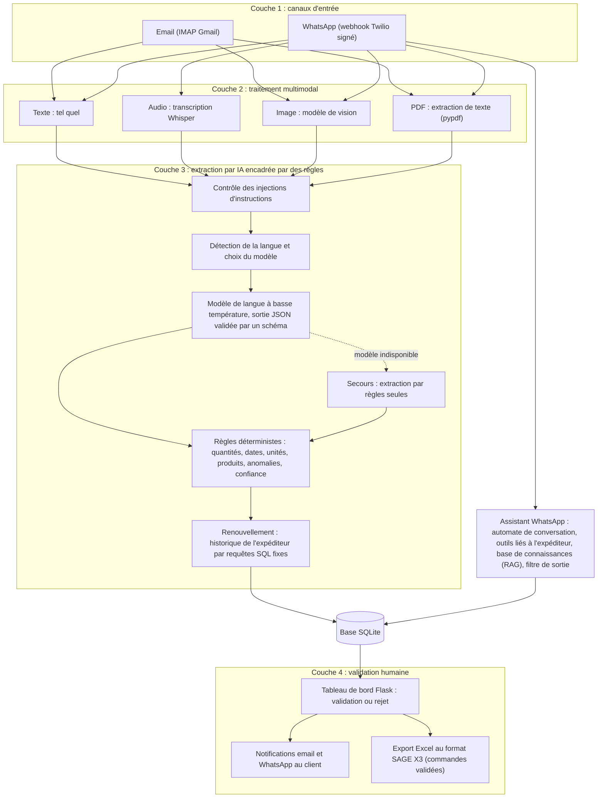

# Présentation du projet TECPAP en entretien

Ce document réunit ce que je dis, ce que je montre et ce que je réponds quand je présente le projet TECPAP : un pitch de deux minutes, une version détaillée de cinq à sept minutes, les résultats avec leurs limites, les questions probables et un glossaire. Les chiffres techniques viennent des fichiers de `evaluation/results/` et de la collecte des tests ; le seul chiffre métier, le gain de temps de réponse, est un résultat rapporté par l'équipe TECPAP et non mesuré dans ce dépôt.

Sommaire :

1. [Pitch de 2 minutes](#1-pitch-de-2-minutes)
2. [Version détaillée (5 à 7 minutes)](#2-version-détaillée-5-à-7-minutes)
3. [Résultats](#3-résultats)
4. [Questions probables en entretien](#4-questions-probables-en-entretien)
5. [Glossaire](#5-glossaire)

---

## 1. Pitch de 2 minutes

> *Texte à dire, environ 300 mots.*

La deuxième expérience que je voudrais présenter est un projet d'innovation réalisé avec TECPAP, une entreprise industrielle de Casablanca qui fabrique des sacs en papier kraft.

Le problème : les commandes arrivent de façon hétérogène. Par email, sous forme de texte, parfois avec des pièces jointes. Par WhatsApp, sous forme de messages, de notes vocales ou de photos. Et dans plusieurs langues : français, arabe standard et surtout darija, l'arabe marocain, écrit en lettres arabes ou en lettres latines avec des chiffres. Le traitement manuel était répétitif et demandait deux validations humaines pour saisir chaque commande.

L'objectif : construire un système qui extrait automatiquement les commandes, les prépare pour l'ERP SAGE X3 et laisse l'équipe commerciale les valider.

J'ai construit une application Python avec Flask, en quatre couches. Première couche, les canaux d'entrée : email et WhatsApp. Deuxième couche, le traitement multimodal : le texte part directement à l'extraction, l'audio est transcrit avec Whisper, les images sont lues par le modèle de vision GPT-4o, les PDF sont lus avec pypdf. Troisième couche, l'extraction par un modèle de langue à basse température, encadrée par des règles déterministes. Quand un client veut « comme d'habitude », le système retrouve sa dernière commande validée par des fonctions SQL précises, liées à l'expéditeur : le modèle n'a jamais d'accès libre à la base, et ses réponses passent par un filtre avant l'envoi. Quatrième couche, un tableau de bord où l'équipe commerciale valide ou rejette chaque commande.

Le résultat, rapporté par l'équipe TECPAP : une tâche répétitive devenue automatique et plus de 70 % du temps de réponse au client économisé.

Ce que j'en retiens : un modèle de langue ne doit jamais être la seule source de vérité. Il faut des règles déterministes, des autorisations vérifiées dans le code et une validation humaine. J'ai aussi appris à écouter l'équipe métier pour comprendre ses contraintes.

---

## 2. Version détaillée (5 à 7 minutes)

### 2.1 Contexte et problème

TECPAP fabrique des sacs en papier kraft à Bouskoura, près de Casablanca. Ses clients (boulangeries, restauration rapide, commerces) commandent par deux canaux :

| Canal | Formes du message |
| --- | --- |
| Email (boîte Gmail lue en IMAP) | Texte, PDF ou images en pièce jointe |
| WhatsApp (webhook Twilio) | Texte, note vocale, photo, PDF |

Le même message peut être une commande, une demande de renseignement, un suivi (« où est ma commande ? »), un renouvellement (« comme d'habitude », « kif dima ») ou, plus rarement, un texte rédigé pour détourner un assistant automatique. Avant le projet, une personne lisait chaque message, le retapait dans l'ERP, puis une seconde validation avait lieu : une tâche répétitive qui retardait la réponse au client.

### 2.2 Contraintes

| Contrainte | Conséquence dans la conception |
| --- | --- |
| Langues : français, anglais, arabe standard, darija en lettres arabes ou latines (arabizi) | Détection de la langue par règles et choix du modèle selon la langue |
| Canaux multiples et formats variés | Couche de conversion en texte avant toute extraction |
| Messages courts, dictés, mêlant darija et français dans la même phrase | Règles de normalisation propres à ces écritures |
| Données de clients (prix, coordonnées, historique) | Autorisations vérifiées dans le code, filtre des sorties, aucun accès SQL libre |
| Messages hostiles possibles (email ou WhatsApp) | Détection d'injection d'instructions, contenu externe traité comme donnée |
| ERP SAGE X3 | Colonnes de la base alignées sur le format des commandes SAGE X3, export Excel au format d'import |
| Modèle indisponible ou erreur de l'API | Extraction par règles en secours, commande toujours acheminée vers le tableau de bord |

### 2.3 Architecture

Lecture du schéma : un message entre par un canal, est converti en texte, contrôlé, extrait par le modèle puis contrôlé et complété par des règles, et enregistré « en attente ». Rien n'atteint l'ERP sans la validation de l'équipe commerciale : l'export SAGE X3 ne contient que des commandes validées (`tecpap/reporting/analytics.py`). Pour WhatsApp, l'assistant conversationnel complète d'abord la commande avec le client, puis l'enregistre au même statut « en attente ».

### 2.4 Choix techniques justifiés

**Le choix du modèle selon la langue** (`tecpap/llm/router.py`). Chaque appel passe par un routeur qui renvoie le modèle, la température et une phrase de justification, conservée avec la commande pour l'audit. La darija et l'arabe sont des langues peu dotées pour les modèles de langue (peu de textes d'entraînement, pas d'orthographe unique en lettres latines) : le modèle principal (`gpt-4o` par défaut) est préféré pour toute langue autre que le français et l'anglais, et toujours pour l'extraction, parce que chaque champ extrait alimente la commande. Le modèle léger (`gpt-4o-mini` par défaut) ne sert que pour les tâches courtes en français ou en anglais (détection de renouvellement, classification, réponse brève). Les noms de modèles se règlent par variables d'environnement.

**Un modèle à basse température.** La température par défaut est de 0,1 : plus elle est basse, plus la réponse est stable et reproductible. Pour une réponse rédigée au client, elle est plafonnée à 0,2.

**Des règles déterministes autour du modèle** (`tecpap/extraction/`). La réponse du modèle est un objet JSON validé par un schéma, puis normalisée par des règles fixes : quantités écrites en chiffres ou en lettres, unités, dates, type de produit, code article SAGE X3. Le niveau de confiance est calculé par ces règles, pas déclaré par le modèle, et chaque anomalie retire des points. Si la clé d'API est absente ou si l'appel échoue, l'extraction par règles prend le relais : la commande arrive au tableau de bord avec une anomalie explicite et une confiance plafonnée à 50 %, sous le seuil des alertes de confiance faible (60 %).

**Le renouvellement, avec reprise de l'historique par des fonctions SQL précises.** Les règles détectent d'abord les expressions de renouvellement ; le modèle léger n'est consulté que si les règles ne trouvent rien dans un texte assez long (au moins 60 caractères) pour être ambigu. Pour compléter la commande, le système lit la dernière commande **validée** envoyée par le **même expéditeur** (même adresse email, ou même numéro WhatsApp), par une requête SQL fixe et paramétrée. Le nom d'un client cité dans le message ne donne jamais accès à l'historique de ce client. Seuls les champs manquants sont complétés, et les champs propres à un produit (désignation, prix) ne sont repris que si le produit est le même. Sans historique, une anomalie demande à l'équipe commerciale de compléter la commande.

**Les autorisations dans le code, pas dans les consignes du modèle** (`tecpap/chatbot/tools.py`). L'assistant WhatsApp n'accède aux données que par cinq outils : `my_recent_orders`, `my_order_status`, `my_last_validated_order`, `search_catalog` et `request_human`. L'objet d'outils est construit pour un expéditeur, dont le numéro est fixé à la construction : aucun outil ne prend de numéro ou de client en paramètre, un argument inattendu est ignoré, chaque requête SQL filtre elle-même sur l'expéditeur, et les résultats sont réduits au minimum (référence, date, produit, quantité, unité, statut), sans prix ni coordonnées. Même une consigne détournée ne peut donc pas faire lire la commande d'un autre client.

**Un filtre avant de répondre** (`tecpap/security/guardrails.py`). Tout texte rédigé par le modèle passe par un filtre de sortie qui bloque la réponse si elle contient le jeton témoin (code aléatoire placé dans les consignes système, qui prouve une fuite s'il apparaît), un passage recopié des consignes, une requête SQL, une clé d'API ou un chemin interne, et qui masque les numéros et emails autres que ceux de l'expéditeur et de TECPAP. Côté entrée, les messages sont normalisés (homoglyphes, lettres espacées, contenus encodés en base64 ou hexadécimal…) puis comparés à des signaux pondérés en français, anglais, arabe et darija ; le contenu externe est délimité par des balises et présenté au modèle comme une donnée. Ces contrôles sont une défense en profondeur ; l'autorisation, elle, ne dépend pas d'eux.

**La base de connaissances et la RAG** (`tecpap/rag/`). Pour les questions sur les produits, l'assistant ne répond qu'à partir de cinq documents Markdown de la base de connaissances (53 extraits). La recherche combine un classement par mots-clés (BM25) et un classement par similarité de vecteurs, fusionnés par rangs réciproques (RRF). Si le meilleur extrait est sous le seuil de pertinence (0,23 par défaut), l'assistant répond qu'il n'a pas l'information, sans appeler le modèle. Les questions de prix, de délai, de stock, de remise, de paiement ou de quantité minimale reçoivent directement un message qui les oriente vers l'équipe commerciale, et la conversation est transférée à un conseiller, car ces informations ne figurent pas dans la base et un modèle risquerait de les inventer. Enfin, tout montant ou toute durée cité dans la réponse du modèle doit figurer dans les extraits, sinon la réponse est remplacée.

**L'assistant WhatsApp** (`tecpap/chatbot/`). C'est un automate à quatre états (`idle`, `collecting`, `awaiting_confirmation`, `handoff`) dont les intentions sont détectées par règles : le modèle ne décide ni de l'état ni de l'enregistrement. Une commande n'est enregistrée qu'après l'accord explicite du client (« oui », « wakha », « نعم »), toujours au statut « en attente ». Un message suspect reçoit une réponse fixe, sans appel au modèle ; au-delà de 10 messages par minute et par numéro (valeur par défaut), le premier message en trop reçoit un avertissement et les suivants aucune réponse ; au niveau du webhook, la limite est vérifiée avant le téléchargement d'un média, ce qui évite aussi les coûts de transcription et de lecture d'image. Une demande d'un conseiller met la conversation en état `handoff` : l'assistant n'accuse plus que réception jusqu'à la remise à zéro depuis le tableau de bord.

**La validation humaine** (`tecpap/web/`). Le tableau de bord Flask liste les commandes avec leur confiance, leurs anomalies, les champs manquants, le modèle utilisé et la raison de ce choix. L'équipe valide ou rejette, le client est notifié par email ou WhatsApp, et l'export au format SAGE X3 ne reprend que les commandes validées. L'accès est protégé : un seul compte administrateur dont le mot de passe n'existe que sous forme d'empreinte, blocage des tentatives répétées, protection contre la falsification de requête intersite (CSRF), en-têtes de sécurité. Le webhook Twilio est protégé par la vérification de la signature de chaque requête.

**La fiabilité du traitement.** Le webhook enregistre chaque message signé dans une file durable (table SQLite) avant de répondre à Twilio : un message accepté n'est pas perdu si le processus s'arrête, et un message livré deux fois n'est traité qu'une fois. Les notes vocales et les images peuvent dépasser le délai de 15 secondes de Twilio : le traitement a lieu en tâche de fond et la réponse part par l'API REST de Twilio.

### 2.5 Ce que j'ai appris

1. Un modèle de langue n'est jamais la seule source de vérité. Les règles déterministes améliorent la qualité de sortie, et l'autorisation doit se vérifier dans le code, pas dans une consigne.
2. Mesurer sur des messages qui n'ont pas servi à régler les règles change le diagnostic : sur le jeu de développement, tout est à 100 %, ce qui est trompeur (section 3).
3. La darija écrite en lettres latines ou arabes, les messages dictés et l'alternance entre darija et français ne se traitent pas comme du texte propre : il faut des données de messages réels et des règles propres à ces écritures.
4. Dialoguer avec l'équipe commerciale pour comprendre ses contraintes (qui valide, sur quoi, avec quelles informations sous les yeux) a décidé de la forme du tableau de bord et du statut « en attente ».

---

## 3. Résultats

### 3.1 Résultat métier rapporté par l'équipe TECPAP

L'équipe TECPAP rapporte que le système a transformé une tâche répétitive en tâche automatique et économisé **plus de 70 % du temps de réponse au client**, avec une meilleure satisfaction des clients. **Ce gain n'est pas mesuré par ce dépôt** : il n'existe ici ni mesure de temps de réponse avant et après, ni enquête de satisfaction. Je le présente comme un retour de l'équipe, pas comme un résultat que je peux reproduire.

### 3.2 Évaluation hors ligne : ce qu'elle mesure et ce qu'elle ne mesure pas

L'évaluation (`evaluation/run_eval.py`, détails dans `evaluation/README.md`) mesure la **couche déterministe uniquement** : détection de la langue, extraction par règles (type de produit, quantité, unité, client), détection des commandes et des renouvellements, détection des intentions de l'assistant et détection des injections d'instructions. Elle ne mesure **pas la qualité du modèle de langue** : le mode `--online`, qui ferait passer les commandes par le modèle, existe mais n'a pas été exécuté. Les chiffres ci-dessous ne disent donc rien de l'exactitude des extractions faites par le modèle.

Le corpus annoté est coupé en deux parties (split dev/test, c'est-à-dire développement et test) :

| Partition | Rôle | Éléments | Commandes | Injections |
| --- | --- | ---: | ---: | ---: |
| Développement (`dev`) | Écrire et ajuster les règles, les mots-clés et les seuils | 198 | 98 | 39 |
| Test (`test`) | Mesurer seulement, jamais de réglage | 134 | 63 | 28 |

Les erreurs du jeu de développement servent à corriger les règles : ses scores surestiment donc la qualité réelle. Le jeu de test, tenu à l'écart, donne une estimation sur des messages que les règles n'ont jamais vus. La seule comparaison honnête est celle du jeu de test.

### 3.3 Chiffres de `evaluation/results/synthese.md`

Les intervalles sont des intervalles de confiance à 95 % (intervalle de score de Wilson) : plus l'effectif est petit, plus la plage est large. Exécution du 25 octobre 2026.

| Composant | Mesure | Développement | Test | Intervalle de confiance à 95 % (test) | Écart (points) |
| --- | --- | ---: | ---: | ---: | ---: |
| Détection de la langue | Exactitude | 198/198 (100,0 %) | 133/134 (99,3 %) | [95,9 % ; 99,9 %] | −0,7 |
| Extraction par règles | Type de produit | 98/98 (100,0 %) | 62/63 (98,4 %) | [91,5 % ; 99,7 %] | −1,6 |
| Extraction par règles | Quantité | 98/98 (100,0 %) | 60/63 (95,2 %) | [86,9 % ; 98,4 %] | −4,8 |
| Extraction par règles | Unité | 98/98 (100,0 %) | 58/63 (92,1 %) | [82,7 % ; 96,6 %] | −7,9 |
| Extraction par règles | Client (`entreprise_cliente`) | 98/98 (100,0 %) | 52/63 (82,5 %) | [71,4 % ; 90,0 %] | −17,5 |
| Extraction par règles | Champs obligatoires | 98/98 (100,0 %) | 48/63 (76,2 %) | [64,4 % ; 85,0 %] | −23,8 |
| Détection des commandes | Exactitude | 198/198 (100,0 %) | 129/134 (96,3 %) | [91,6 % ; 98,4 %] | −3,7 |
| Détection des commandes | Rappel | 98/98 (100,0 %) | 58/63 (92,1 %) | [82,7 % ; 96,6 %] | −7,9 |
| Détection des renouvellements | Précision | 14/14 (100,0 %) | 12/12 (100,0 %) | [75,8 % ; 100,0 %] | 0,0 |
| Détection des renouvellements | Rappel | 14/14 (100,0 %) | 12/13 (92,3 %) | [66,7 % ; 98,6 %] | −7,7 |
| Détection des injections | Précision | 39/39 (100,0 %) | 23/23 (100,0 %) | [85,7 % ; 100,0 %] | 0,0 |
| Détection des injections | Rappel | 39/39 (100,0 %) | 23/28 (82,1 %) | [64,4 % ; 92,1 %] | −17,9 |
| Détection des injections | Taux de faux positifs | 0/159 (0,0 %) | 0/106 (0,0 %) | [0,0 % ; 3,5 %] | 0,0 |
| Détection des intentions | Exactitude | 198/198 (100,0 %) | 124/134 (92,5 %) | [86,8 % ; 95,9 %] | −7,5 |
| Détection des intentions | Macro-F1 | 100,0 % | 91,9 % | non calculé | −8,1 |

Définitions : le rappel est la part des cas à détecter qui l'ont été ; la précision est la part des signalements justes ; le taux de faux positifs est la part des messages légitimes signalés à tort ; le F1 est la moyenne harmonique de la précision et du rappel, et le macro-F1 la moyenne des F1 de toutes les classes d'intention.

Lecture :

- Sur le jeu de test, les trois mesures dont les intervalles ne chevauchent pas ceux du jeu de développement sont le repérage du client (−17,5 points), les champs obligatoires (−23,8 points) et l'exactitude des intentions (−7,5 points). Ces écarts ne s'expliquent pas bien par le seul hasard de l'échantillonnage : les règles ne généralisent pas aussi bien que le jeu de développement le laissait croire.
- Aucune fausse alerte sur les messages légitimes, en développement comme en test : une commande légitime n'est pas bloquée par la détection d'injection.
- Le rappel de la détection d'injection est de 82,1 % sur le jeu de test, avec un intervalle large ([64,4 % ; 92,1 %]) : 5 injections sur 28 ne sont pas signalées par les règles. C'est une raison de plus pour que la sécurité ne repose pas sur cette détection seule (section 4, question 2).
- Avec 134 éléments en test, les intervalles restent larges : ces chiffres sont des ordres de grandeur, pas des garanties.

### 3.4 Autres chiffres du dépôt

| Information | Valeur | Source |
| --- | --- | --- |
| Tests automatisés collectés | 7 042 | `pytest --co -q` (collecte, sans exécution) |
| Documents de la base de connaissances | 5 | dossier `knowledge/` (hors guide de rédaction) |
| Extraits indexés de la base de connaissances | 53 | `tecpap.rag.documents.load_chunks` |
| Version | 3.0.0 | `tecpap/__init__.py` |

---

## 4. Questions probables en entretien

**1. Pourquoi ne pas donner un accès SQL libre au modèle ?**
Parce qu'un accès libre ferait reposer la confidentialité sur la bonne volonté du modèle. J'ai préféré cinq outils de lecture fixes, construits pour un expéditeur dont le numéro est fixé dans le code : aucun outil ne prend de numéro ou de client en paramètre, chaque requête SQL est paramétrée et filtre sur l'expéditeur, et les résultats sont réduits (pas de prix, pas de coordonnées). Le pire cas d'une consigne détournée est la lecture des commandes de l'expéditeur lui-même.

**2. Comment empêchez-vous l'injection d'instructions ?**
Je ne prétends pas l'empêcher à coup sûr ; je réduis le risque en couches. Le texte est normalisé puis comparé à des signaux pondérés dans quatre langues et écritures ; les contenus encodés sont décodés ; le contenu externe est délimité par des balises et présenté comme une donnée ; un jeton témoin et un filtre de sortie détectent une fuite des consignes. Surtout, l'impact est borné par le code : outils limités à l'expéditeur, commande toujours « en attente » jusqu'à la validation humaine, confiance calculée par des règles. Le rappel de la détection est de 82,1 % sur le jeu de test : elle ne suffirait pas seule.

**3. Que se passe-t-il si le modèle de langue est indisponible ?**
Le client de modèles ne lève jamais d'exception vers l'appelant : il journalise l'incident et renvoie « rien », après un seul nouvel essai pour les erreurs passagères. L'extraction par règles prend alors le relais, la commande est enregistrée avec l'anomalie « extraction par règles » et une confiance plafonnée à 50 %, et l'équipe commerciale vérifie tous les champs. L'assistant WhatsApp répond par ses modèles de messages fixes ; une question sur les produits reçoit une citation de l'extrait le plus pertinent.

**4. Pourquoi un jeu de test tenu à l'écart ?**
Parce que les erreurs du jeu de développement servent à écrire les règles : mesuré dessus, un composant obtient 100 % sans que cela prouve quoi que ce soit. Le jeu de test ne sert jamais au réglage, et ses chiffres sont publiés tels quels. La méthode a déjà servi : le premier jeu tenu à l'écart avait révélé un écart de généralisation ; il a été versé aux données de développement et un second jeu de test a été rédigé. Sur ce second jeu, la lecture du client et les champs obligatoires baissent nettement (−17,5 et −23,8 points).

**5. Pourquoi la darija est-elle difficile ?**
Quatre raisons. Les modèles ont vu peu de textes dans cette langue. Elle s'écrit en lettres arabes ou en lettres latines avec des chiffres (3 pour ع, 7 pour ح, 9 pour ق), sans orthographe unique. Elle partage son alphabet avec l'arabe standard, ce qui met en défaut les détecteurs de langue statistiques. Enfin, les messages sont courts (« wakha », « ok »), dictés sans ponctuation et mêlent darija et français dans la même phrase. Mes réponses : détection de la langue par mots marqueurs (déterministe, sans modèle), règles de normalisation propres à ces écritures, modèle principal préféré pour toute langue autre que le français et l'anglais, et un corpus d'évaluation qui contient des messages dans ces écritures.

**6. Comment passeriez-vous à l'échelle ?**
Aujourd'hui l'application tourne dans un seul processus (gunicorn, un worker, quatre fils) avec une base SQLite en mode WAL, parce que le planificateur de sauvegardes, l'exécuteur des tâches de fond, les verrous par expéditeur et les compteurs de connexions sont en mémoire. Pour monter en charge : migrer vers PostgreSQL (plusieurs écritures simultanées, plusieurs processus), remplacer la file durable SQLite et l'exécuteur de tâches par une vraie file de messages avec des consommateurs séparés, sortir les tâches planifiées (sauvegardes, maintenance) du processus web, et partager l'état aujourd'hui en mémoire (verrous par expéditeur, compteurs d'échecs de connexion). Ce n'est pas implémenté : ce sont des pistes, et la file durable déjà en place (statuts, reprise, déduplication) en est la première brique.

**7. Combien cela coûte-t-il ?**
Je n'ai pas de chiffre de coût mesuré à vous donner, et je ne veux pas en inventer. Ce que je peux décrire, ce sont les leviers de coût présents dans le code : modèle léger pour les tâches courtes en français et en anglais, règles avant le modèle pour détecter un renouvellement, aucune recherche ni appel au modèle pour une question de prix, calcul local gratuit des vecteurs de recherche par défaut, limite de débit vérifiée avant de télécharger un média (transcription et lecture d'image sont payantes), et un seul nouvel essai en cas d'erreur passagère.

**8. Pourquoi une validation humaine si l'IA fonctionne ?**
Parce qu'une erreur de quantité ou de produit se paie en production et que le modèle ne peut pas répondre de ses erreurs. La validation est aussi ce qui rend le système sûr : l'export SAGE X3 ne contient que des commandes validées, et même une injection réussie n'écrirait qu'une commande « en attente ». Le tableau de bord montre la confiance, les anomalies, les champs manquants et le message d'origine pour que la relecture soit rapide.

**9. D'où vient la confiance affichée : du modèle ?**
Non. Elle est calculée par des règles à partir de la complétude des champs obligatoires, et chaque anomalie (contenu suspect, extraction par règles, renouvellement sans historique…) retire des points. Demander au modèle d'évaluer sa propre confiance est peu fiable : il peut se tromper avec assurance.

**10. Comment évitez-vous de mélanger les historiques de deux clients ?**
L'historique n'est lu que pour l'expéditeur du message (même adresse email, ou même numéro WhatsApp), par une requête fixe, et seulement sur les commandes validées. Citer le nom d'un autre client dans le message ne donne aucun accès. Le téléphone enregistré pour un client n'ouvre pas non plus l'accès à ses commandes : seules comptent les commandes envoyées depuis le numéro de l'expéditeur.

**11. Que se passe-t-il si Twilio livre deux fois le même message, ou si le serveur s'arrête en plein traitement ?**
L'identifiant du message (`MessageSid`) est unique dans la file durable : une seconde livraison est ignorée. Le message est enregistré avant la réponse à Twilio ; s'il n'a pas été traité au moment de l'arrêt, il est repris au démarrage et par la maintenance périodique, avec un nombre maximal de prises en charge avant abandon.

**12. Pourquoi une base de connaissances plutôt que de laisser le modèle répondre seul ?**
Pour que l'assistant ne dise que ce que TECPAP a écrit. Les réponses viennent des extraits retrouvés, en trois phrases au plus ; en dessous du seuil de pertinence, l'assistant dit qu'il n'a pas l'information ; les prix et les délais ne sont jamais donnés par le modèle ; un chiffre absent des extraits fait remplacer la réponse. Ce choix limite les réponses inventées, qui seraient le risque principal d'un assistant de vente.

**13. Pourquoi l'export vers l'ERP passe-t-il par un fichier Excel et non par une connexion directe ?**
Le dépôt prépare les commandes au format d'import de SAGE X3 (colonnes de la base alignées sur les commandes SAGE X3, feuille d'export, quantités en unités de stock) et c'est l'équipe qui importe le fichier après validation. Une connexion directe n'est pas implémentée : elle supposerait un accès à l'API de l'ERP et une gestion des erreurs d'écriture, et l'import par fichier garde l'humain dans la boucle.

**14. Quelles sont les limites du projet ?**
- L'évaluation hors ligne ne mesure pas le modèle de langue ; le mode `--online` n'a pas été exécuté.
- Le jeu de test compte 134 éléments : les intervalles de confiance sont larges.
- La lecture du client et des champs obligatoires par les règles généralise moins bien (76,2 % pour les champs obligatoires en test) ; c'est la validation humaine qui rattrape ces cas.
- La détection d'injection manque 5 cas sur 28 en test.
- La base de connaissances ne compte que cinq documents et ne couvre pas l'anglais : une question en anglais obtient plus souvent la réponse « je n'ai pas cette information ».
- Le gain de plus de 70 % du temps de réponse est rapporté par l'équipe, non mesuré dans le dépôt.
- L'architecture à un processus et SQLite convient à la charge d'une PME, pas à une forte montée en charge.

**15. Que feriez-vous ensuite ?**
Trois priorités. Exécuter l'évaluation en ligne pour mesurer l'extraction par le modèle, avec le même découpage dev/test. Enrichir le jeu de test, surtout en darija, pour resserrer les intervalles. Mesurer le temps de réponse avant et après sur des données de l'équipe TECPAP, pour remplacer un chiffre rapporté par une mesure.

---

## 5. Glossaire

| Terme | Définition |
| --- | --- |
| Arabizi | Écriture de l'arabe dialectal avec l'alphabet latin et des chiffres (3 = ع, 7 = ح, 9 = ق). |
| Baseline | Point de comparaison de référence : méthode simple à battre avant d'en adopter une plus complexe. |
| BM25 (Okapi BM25) | Score de recherche par mots-clés : un extrait est d'autant mieux classé qu'il contient les mots rares de la question. |
| Canal | Voie d'arrivée d'un message : email ou WhatsApp. |
| Consignes système (system prompt) | Texte donné au modèle de langue pour définir son rôle et ses règles, avant le message du client. |
| CSRF (falsification de requête intersite) | Attaque qui fait envoyer, par le navigateur d'un utilisateur connecté, une requête qu'il n'a pas voulue. |
| Darija | Arabe dialectal marocain, écrit en lettres arabes ou latines. |
| ERP (SAGE X3) | Progiciel de gestion intégré de TECPAP, où les commandes validées sont importées. |
| Filtre de sortie | Contrôle appliqué à une réponse générée avant son envoi : bloque les fuites, masque les coordonnées non autorisées. |
| Fusion par rangs réciproques (RRF, Reciprocal Rank Fusion) | Fusion de plusieurs classements : chaque extrait reçoit la somme de 1 / (60 + rang) sur les classements où il figure. |
| Génération augmentée par la recherche (RAG, Retrieval-Augmented Generation) | Méthode où le modèle rédige sa réponse à partir d'extraits retrouvés dans une base de connaissances. |
| Injection d'instructions (prompt injection) | Texte rédigé pour détourner le modèle de langue de sa tâche. |
| Intervalle de confiance à 95 % | Plage de valeurs compatibles avec l'échantillon ; ici calculée par la méthode de Wilson. |
| Jeton témoin (canary token) | Code aléatoire placé dans les consignes système ; sa présence dans une réponse prouve une fuite des consignes. |
| Modèle de langue (LLM, Large Language Model) | Modèle d'intelligence artificielle qui lit et produit du texte. |
| Modèle de vision | Modèle de langue capable de lire le texte d'une image ; ici GPT-4o. |
| Plongement vectoriel (embedding) | Représentation d'un texte par un vecteur de nombres ; deux textes proches ont des vecteurs proches. |
| Précision, rappel, F1 | Part des signalements justes ; part des cas à détecter trouvés ; moyenne harmonique des deux. |
| Renouvellement (reorder) | Commande qui répète une commande précédente (« comme d'habitude », « kif dima »). |
| Split dev/test | Séparation d'un corpus en un jeu de développement, qui sert au réglage, et un jeu de test, qui sert seulement à mesurer. |
| Température | Paramètre du modèle : plus elle est basse, plus la réponse est stable et reproductible. |
| Transfert à un conseiller (handoff) | Passage d'une conversation de l'assistant à l'équipe commerciale. |
| Twilio | Service qui relie l'application à WhatsApp et signe chaque requête envoyée au webhook. |
| Webhook | Adresse de l'application appelée par un service externe (ici Twilio) à chaque message reçu. |
| Whisper | Modèle de transcription de la parole en texte, utilisé pour les notes vocales. |
| WAL (Write-Ahead Logging) | Mode de journalisation de SQLite : lectures en parallèle, écritures l'une après l'autre. |
